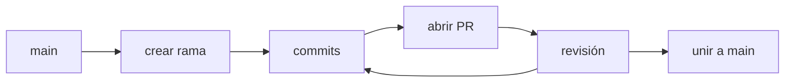

# Cómo trabajamos en Calida

Reglas para que dos o más personas trabajen en el mismo repositorio sin pisarse. Son pocas a propósito: cada una resuelve un problema concreto, explicado en su sección.

Contexto del proyecto: [docs/00 · Guía](docs/00-guia-de-proyecto.md) (fase 3) y [docs/04 · Arquitectura §11.2](docs/04-arquitectura.md).

---

## 1. La regla principal: nada entra a `main` sin Pull Request

`main` es la versión que funciona. Nadie hace `git push` directo a `main`: cada cambio vive en su propia **rama** y entra por un **Pull Request** (PR) que otra persona revisa.

**Por qué:** si dos personas suben directo a `main`, un error de una rompe el trabajo de la otra, y nadie lo revisó antes. El PR es el momento de leer el cambio, hacer preguntas y, más adelante, dejar que GitHub Actions corra el lint y las pruebas.



## 2. Ramas

**Formato:** `tipo/descripcion-corta`, en minúsculas, sin tildes ni espacios (con guiones).

| Tipo | Para qué | Ejemplo |
|---|---|---|
| `funcion/` | Una función nueva del sistema (normalmente un caso de uso). | `funcion/uc09-inscripcion` |
| `correccion/` | Arreglar algo que funciona mal. | `correccion/cupo-negativo` |
| `docs/` | Solo documentos. | `docs/fase-3-convenciones` |
| `config/` | Entorno y herramientas: dependencias, Docker, lint, CI. | `config/monorepo` |
| `prueba/` | Agregar o arreglar pruebas automáticas. | `prueba/reglas-inscripcion` |

**Por qué por tipo y no por persona:** el nombre dice *qué cambia*, que es lo que importa al revisar. Quién la hizo ya lo dice Git en cada commit.

**Reglas:**
- Una rama, un propósito. Si aparece otra tarea, va en otra rama.
- Ramas cortas: de horas o pocos días. Mientras más vive una rama, más se aleja de `main` y más conflictos tiene al unirla.
- Antes de abrir el PR, trae lo último de `main` a tu rama:
  ```bash
  git switch main
  git pull
  git switch tu-rama
  git merge main
  ```

## 3. Commits

**Formato:** un verbo en **infinitivo**, en español, que diga qué hace el commit. La primera línea tiene máximo 72 caracteres y no lleva punto final.

```
Agregar ruta GET /api/salud que consulta la base

La interfaz la usa para mostrar si la API y la base están conectadas.
Es el esqueleto caminante de la fase 3.
```

- **Primera línea:** *qué* hace. Debe completar la frase "Este commit va a…": "…agregar ruta GET /api/salud".
- **Cuerpo (opcional, después de una línea en blanco):** *por qué*. El código ya muestra el cómo.
- **Identificadores:** si el cambio responde a un requisito o decisión, se nombra (`UC-09`, `RN-07`, `ADR-18`). Así se encuentra después con `git log --grep UC-09`.

| ✅ Así | ❌ Así no | Por qué |
|---|---|---|
| `Agregar hoja de inscripción (UC-09)` | `cambios` | No dice nada. |
| `Corregir cupo negativo al cancelar` | `arreglé un bug` | No dice cuál. |
| `Mover contratos.js a compartido/` | `Movi contratos y agregue docker y el lint` | Tres cosas distintas en un commit: van en tres. |

**Un commit, una idea.** Si el mensaje necesita "y además", probablemente son dos commits.

## 4. Pull Requests

1. Sube tu rama: `git push -u origin tu-rama`.
2. Abre el PR en GitHub hacia `main`. La plantilla (`.github/pull_request_template.md`) aparece sola: llénala.
3. **La otra persona lo revisa.** Lee el cambio, lo prueba si hace falta y comenta. Se aprueba o se piden cambios.
4. Cuando está aprobado (y, desde el paso 8 de la fase 3, cuando GitHub Actions pasa), se une con **"Squash and merge"**.
5. Se borra la rama.

**Por qué "Squash and merge":** junta todos los commits del PR en uno solo dentro de `main`. Los commits de trabajo ("probar otra cosa", "corregir typo") se quedan en el PR, y `main` tiene un commit por cambio completo, fácil de leer y de deshacer.

**Un PR pequeño se revisa bien; uno grande se aprueba sin leer.** Como guía: menos de unas 400 líneas cambiadas.

## 5. Lo que nunca va al repositorio

- **Archivos `.env`** con contraseñas o llaves. Solo va `.env.example`, sin valores reales. Si un secreto se sube por error, borrarlo después **no basta** (queda en el historial): hay que cambiar ese secreto.
- `node_modules/`: se reconstruye con `npm install`.
- Archivos generados (carpetas `dist/`, capturas de pantalla, archivos temporales).

El archivo `.gitignore` se encarga de casi todo esto, pero vale la pena revisar `git status` antes de cada commit.

## 6. En GitHub (configuración de quien administra el repositorio)

Para que la regla 1 la cumpla GitHub y no solo la memoria, en **Settings → Branches** se agrega una regla para `main`:

- [ ] *Require a pull request before merging*, con 1 aprobación.
- [ ] *Require status checks to pass* (se activa en el paso 8, cuando exista la revisión de GitHub Actions).
- [ ] En **Settings → General → Pull Requests**, dejar solo *Allow squash merging*.
