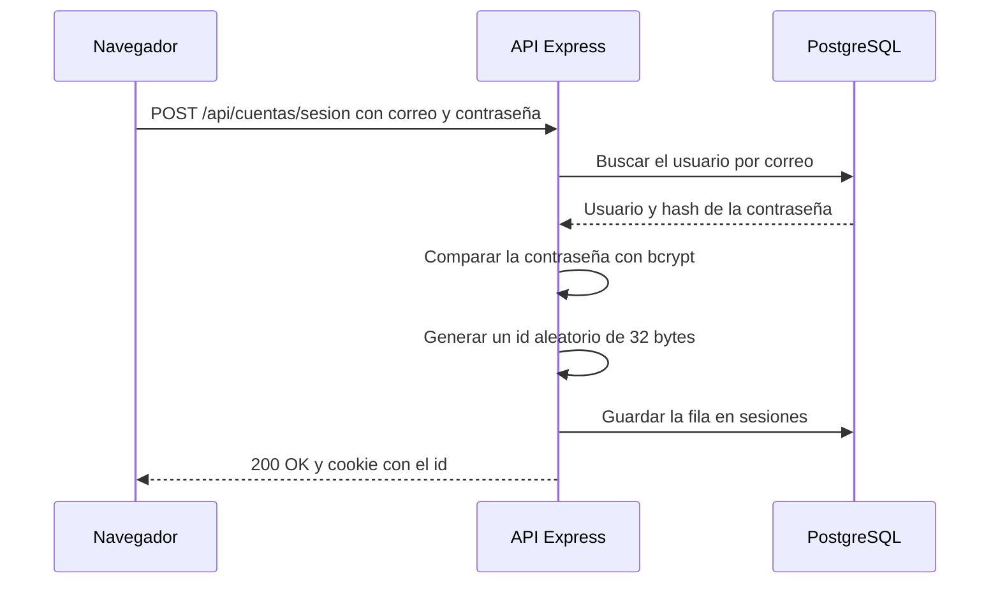
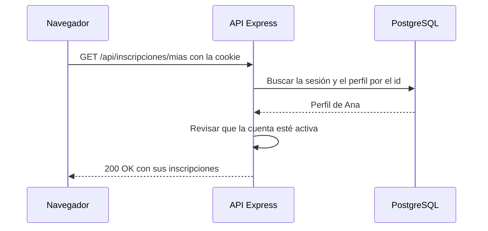
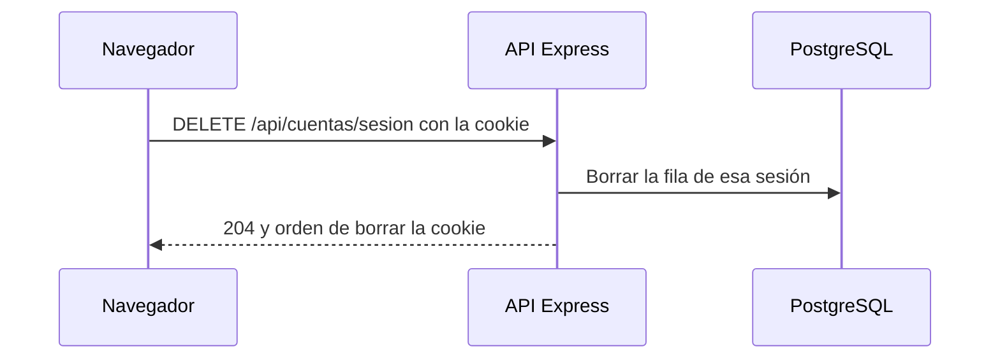

# 03 · Sesiones en el servidor

**Categoría:** Autenticación · **Se usa en Calida:** sí, es el mecanismo de inicio de sesión ([04 · §7.1](../docs/04-arquitectura.md), ADR-18)

> Lee antes [01 · Cookies](01-cookies.md). Para comparar con la alternativa descartada, ver [02 · JWT](02-jwt.md).

---

## 1. El problema que resuelve

HTTP no recuerda nada entre una petición y otra (ver [01 · Cookies](01-cookies.md)). Después del login, cada petición tiene que demostrar quién es el usuario. Hay dos grandes formas de hacerlo:

| | Sesión en el servidor (**Calida**) | Token autocontenido (JWT) |
|---|---|---|
| Qué guarda el navegador | Un **id aleatorio**, sin significado. | Los datos del usuario, firmados. |
| Dónde está la información | En la **base de datos del servidor**. | Dentro del token. |
| Cómo sabe el servidor quién eres | **Busca el id** en su tabla. | Verifica la firma. |

## 2. ¿Qué es una sesión?

Una sesión es **el registro, guardado en el servidor, de que un usuario ya demostró quién es**. En Calida es una fila de la tabla `sesiones`.

> **Analogía: el guardarropa.** Entregas tu abrigo (demuestras quién eres con correo y contraseña) y te dan un ficho con un número (el id de sesión, en una cookie). El ficho no dice nada de ti; solo sirve porque el guardarropa tiene anotado a quién pertenece. Si pierdes el ficho, el encargado puede anularlo. Y cuando te vas, lo devuelves y ese número deja de servir.

Hay tres piezas:

1. **La fila en la base:** `id → usuario, fecha de vencimiento`.
2. **La cookie en el navegador:** guarda solo el `id`.
3. **El middleware en la API:** en cada petición, toma el `id` de la cookie y busca la fila.

## 3. Ciclo de vida de una sesión

Una sesión pasa por tres momentos: se **crea** en el login, se **usa** en cada petición y se **termina** en el logout.

### 3.1 Crear (login)



Lo que viaja de verdad en la respuesta:

```http
HTTP/1.1 200 OK
Set-Cookie: sesion=85d90c72…de6a6; HttpOnly; Secure; SameSite=Lax; Path=/; Max-Age=604800
```

### 3.2 Usar (cada petición)



La consulta que hace el middleware:

```sql
select p.* from sesiones s join perfiles p on p.id = s.usuario_id
where s.id = $1 and s.vence_en > now();
```

Si no devuelve ninguna fila (el id no existe o ya venció), la petición sigue como **visitante**.

### 3.3 Terminar (logout)



Después de esto, aunque alguien tenga una copia de la cookie, el id ya no aparece en la tabla y no sirve.

Una sesión puede terminar de cuatro formas:

| Cómo termina | Qué pasa en la base |
|---|---|
| El usuario cierra sesión | Se borra **esa** fila. |
| Vence (7 días) | La fila sigue ahí, pero `vence_en > now()` ya no se cumple, así que no sirve. Se limpia después. |
| El administrador suspende al usuario | Se borran **todas** sus filas: todos sus dispositivos quedan fuera al instante. |
| El usuario borra su cuenta | `on delete cascade` borra sus sesiones automáticamente. |

## 4. La tabla

```sql
create table sesiones (
  id          text primary key,                               -- 32 bytes aleatorios en hexadecimal
  usuario_id  uuid not null references usuarios(id) on delete cascade,
  creada_en   timestamptz not null default now(),
  vence_en    timestamptz not null                            -- creada_en + 7 días
);
```

- **`id` es la llave primaria**, así que PostgreSQL ya le crea un índice. Buscar una sesión entre millones tarda una fracción de milisegundo.
- **`on delete cascade`**: si se borra el usuario, se borran sus sesiones. La base mantiene el orden sola.
- **Un usuario puede tener varias sesiones**: una en el celular y otra en el computador. Cada dispositivo tiene su propia fila y su propio id.

## 5. El id de sesión: por qué aleatorio y largo

Toda la seguridad depende de que **nadie pueda adivinar un id válido**.

```js
import { randomBytes } from 'node:crypto';
const id = randomBytes(32).toString('hex');
// → "85d90c72a1b85a5cc07bff93abbb143cf8faafd176857f22c4b10c2de0ade6a6"
```

| Opción | ¿Sirve? | Por qué |
|---|---|---|
| `randomBytes(32)` | ✅ | Generador criptográfico: 2²⁵⁶ posibilidades. Adivinar uno es imposible en la práctica. |
| Número consecutivo (1, 2, 3…) | ❌ | Si tu sesión es la 41, la 40 es de otra persona. |
| `Math.random()` | ❌ | No es criptográfico: con algunas salidas se pueden predecir las siguientes. |
| `crypto.randomUUID()` | ⚠️ Aceptable | 122 bits aleatorios: suficiente, pero `randomBytes(32)` deja más clara la intención. |
| Hash del correo o de la fecha | ❌ | Si alguien conoce la receta, lo puede reproducir. |

**El id no lleva ningún dato del usuario.** A diferencia de un JWT, aunque alguien lo lea, no aprende nada: es como el número de un ficho.

## 6. Cómo se usa en Calida (código de la fase 4)

Este es el código que vamos a escribir en la fase de construcción, organizado por capas ([04 · §5](../docs/04-arquitectura.md)).

### 6.1 Repositorio: las consultas SQL

```js
// backend/src/repositorios/sesiones.js
import { db } from '../db.js';

export async function crear(id, usuarioId) {
  await db.query(
    `insert into sesiones (id, usuario_id, vence_en)
     values ($1, $2, now() + interval '7 days')`,
    [id, usuarioId]
  );
}

// Una sola consulta trae la sesión y el perfil del usuario
export async function buscarPerfil(id) {
  const { rows } = await db.query(
    `select p.id, p.rol, p.nombre, p.estado
       from sesiones s
       join perfiles p on p.id = s.usuario_id
      where s.id = $1 and s.vence_en > now()`,
    [id]
  );
  return rows[0] ?? null;          // null si no existe o ya venció
}

export async function borrar(id) {
  await db.query('delete from sesiones where id = $1', [id]);
}

export async function borrarTodasDe(usuarioId) {              // suspensión
  await db.query('delete from sesiones where usuario_id = $1', [usuarioId]);
}

export async function borrarVencidasDe(usuarioId) {           // limpieza al iniciar sesión
  await db.query('delete from sesiones where usuario_id = $1 and vence_en <= now()', [usuarioId]);
}
```

### 6.2 Servicio y controlador: iniciar y cerrar sesión

```js
// backend/src/servicios/cuentas.js (resumido)
import { randomBytes } from 'node:crypto';
import bcrypt from 'bcrypt';
import * as sesiones from '../repositorios/sesiones.js';
import * as usuarios from '../repositorios/usuarios.js';

export async function iniciarSesion(correo, contrasena) {
  const usuario = await usuarios.buscarPorCorreo(correo.toLowerCase());
  const valida = usuario && (await bcrypt.compare(contrasena, usuario.hash_contrasena));
  if (!valida) throw new ErrorNegocio('CREDENCIALES', 'Correo o contraseña incorrectos'); // mensaje genérico (UC-02 A1)
  // (aquí también va el bloqueo por intentos, RF-007)

  await sesiones.borrarVencidasDe(usuario.id);   // no hay tareas programadas (ADR-26)
  const id = randomBytes(32).toString('hex');    // SIEMPRE un id nuevo en cada login
  await sesiones.crear(id, usuario.id);
  return id;
}
```

```js
// backend/src/rutas/cuentas.js (resumido)
const OPCIONES_COOKIE = {
  httpOnly: true,
  secure: process.env.NODE_ENV === 'production',
  sameSite: 'lax',
  path: '/',
  maxAge: 7 * 24 * 60 * 60 * 1000,               // milisegundos; igual a los 7 días de la tabla
};

router.post('/sesion', limiteLogin, async (req, res) => {
  const { correo, contrasena } = esquemaLogin.parse(req.body);   // Zod
  const id = await cuentas.iniciarSesion(correo, contrasena);
  res.cookie('sesion', id, OPCIONES_COOKIE);
  res.json(await cuentas.perfilDeSesion(id));
});

router.delete('/sesion', async (req, res) => {
  if (req.cookies.sesion) await sesiones.borrar(req.cookies.sesion);
  res.clearCookie('sesion', { path: '/' });
  res.status(204).end();
});
```

### 6.3 Middleware: saber quién es en cada petición

Son tres funciones pequeñas, cada una con una sola tarea:

```js
// backend/src/middleware/sesion.js

// 1. Carga el usuario si hay sesión válida. Nunca rechaza: los visitantes también pasan.
export async function cargarSesion(req, res, next) {
  req.usuario = null;
  const id = req.cookies.sesion;
  if (id) {
    const perfil = await sesiones.buscarPerfil(id);
    if (perfil && perfil.estado === 'activo') req.usuario = perfil;   // RN-09: suspendido = sin sesión
  }
  next();
}

// 2. Exige que haya sesión
export function exigirSesion(req, res, next) {
  if (!req.usuario) return res.status(401).json({ error: { codigo: 'SIN_SESION', mensaje: 'Inicia sesión' } });
  next();
}

// 3. Exige uno de ciertos roles
export function exigirRol(...roles) {
  return (req, res, next) => {
    if (!req.usuario) return res.status(401).json({ error: { codigo: 'SIN_SESION', mensaje: 'Inicia sesión' } });
    if (!roles.includes(req.usuario.rol)) return res.status(403).json({ error: { codigo: 'PROHIBIDO', mensaje: 'No tienes permiso' } });
    next();
  };
}
```

```js
// backend/src/app.js
app.use(cookieParser());
app.use(cargarSesion);              // en TODAS las peticiones

// en las rutas:
router.get('/inscripciones/mias', exigirRol('voluntario'), listarMias);
router.get('/iniciativas', listarPublicas);   // sin exigir nada: visitantes también
```

**401 o 403:** `401 Unauthorized` significa "no sé quién eres" (no hay sesión). `403 Forbidden` significa "sé quién eres, pero no puedes hacer esto".

### 6.4 En React: saber si hay sesión

Como la cookie es `HttpOnly`, React no puede leerla. Por eso, al abrir la aplicación, le pregunta a la API:

```jsx
// frontend/src/sesion/SesionContexto.jsx (resumido)
import { createContext, useContext, useEffect, useState } from 'react';

const SesionContexto = createContext(null);

export function ProveedorSesion({ children }) {
  const [usuario, setUsuario] = useState(undefined);    // undefined = todavía preguntando

  useEffect(() => {
    fetch('/api/cuentas/yo')
      .then((r) => (r.ok ? r.json() : null))
      .then(setUsuario);
  }, []);

  async function cerrarSesion() {
    await fetch('/api/cuentas/sesion', { method: 'DELETE' });
    setUsuario(null);
  }

  return (
    <SesionContexto.Provider value={{ usuario, setUsuario, cerrarSesion }}>
      {children}
    </SesionContexto.Provider>
  );
}

export const useSesion = () => useContext(SesionContexto);
```

Cualquier componente puede usar `const { usuario } = useSesion()` para mostrar "Hola, Ana" o el botón de iniciar sesión.

> **Recuerda:** ocultar un botón en React es solo comodidad. Quien decide de verdad es `exigirRol` en la API.

## 7. Vencimiento: absoluto o deslizante

| Tipo | Cómo funciona | Ventaja | Desventaja |
|---|---|---|---|
| **Absoluto** (Calida) | Vence 7 días después del login, se use o no. | Simple. Una sola escritura por sesión. | El usuario activo tiene que volver a entrar cada 7 días. |
| **Deslizante** | Cada vez que el usuario hace algo, se corre `vence_en` hacia adelante. | Quien usa la app seguido nunca tiene que volver a entrar. | Una escritura en la base por petición (o cada cierto tiempo). |

Calida usa vencimiento absoluto por simplicidad. Pasar a deslizante es cambiar una línea: un `update sesiones set vence_en = now() + interval '7 days'` dentro de `cargarSesion`.

## 8. Seguridad

| Riesgo | Qué es | Cómo se cubre |
|---|---|---|
| **Adivinar un id** | Probar ids hasta acertar uno válido. | 32 bytes aleatorios (sección 5). |
| **Robo de la cookie** | Leerla con un script (XSS) o espiando la red. | `HttpOnly` y `Secure` ([01 · Cookies](01-cookies.md)). |
| **CSRF** | Otro sitio hace que tu navegador envíe peticiones con tu cookie. | `SameSite=Lax`. |
| **Fijación de sesión** (*session fixation*) | El atacante te hace usar un id que él ya conoce, y espera a que inicies sesión con ese id. | **Siempre se crea un id nuevo en el login.** El servidor nunca acepta un id que venga del cliente para crear una sesión. |
| **Sesión robada sigue activa** | Alguien copió tu id. | Cerrar sesión borra la fila. Suspender al usuario borra todas sus filas. |
| **Filtración de la base** | Alguien obtiene una copia de la tabla `sesiones`. | Riesgo aceptado en v1 ([04 · §12](../docs/04-arquitectura.md)). Mejora futura: guardar `SHA-256(id)` en la tabla en vez del id. Así, la copia de la base no sirve para entrar. |

**Una buena práctica para más adelante:** cuando un usuario cambie su contraseña, borrar todas sus otras sesiones. Si alguien había entrado con la contraseña vieja, queda fuera.

## 9. ¿Y esto no hace lenta la API?

Cada petición con sesión hace **una consulta** por llave primaria, con un `join` a `perfiles`. Con un índice, eso tarda menos de un milisegundo. En Calida, además, esa consulta **haría falta igual**: necesitamos el estado del perfil para respetar las suspensiones (RN-09). Ese fue justo el motivo para no usar JWT (lección L-04).

Cuando un sistema tiene muchísimo tráfico, las sesiones se guardan en **Redis**, una base de datos en memoria y muy rápida. Para Calida, PostgreSQL sobra.

### ¿Por qué no usar una librería como `express-session`?

Existe, y es muy usada: hace todo esto por ti, guardando las sesiones en memoria, en PostgreSQL (con `connect-pg-simple`) o en Redis. En Calida lo hacemos **a mano** para entender qué pasa por dentro (principio 0 de la arquitectura). Una vez que lo entiendas, usar `express-session` en otro proyecto será fácil.

> ⚠️ El almacenamiento por defecto de `express-session` (`MemoryStore`) guarda las sesiones en la memoria del proceso: se pierden al reiniciar y no sirve para producción.

## 10. Sesiones vs JWT

| | Sesión en la base | JWT |
|---|---|---|
| ¿Qué lleva la cookie? | Un id sin significado | Datos firmados (legibles por cualquiera) |
| ¿Consulta la base en cada petición? | Sí (1 consulta rápida) | No |
| ¿Se puede cerrar sesión de verdad? | **Sí:** se borra la fila | No, hasta que vence |
| ¿Suspender tiene efecto inmediato? | **Sí** | No, salvo con una lista negra |
| ¿Datos siempre actualizados (rol, estado)? | **Sí:** se leen de la base | No: dicen lo que había al crearlo |
| ¿Necesita un secreto que proteger? | No | Sí (`JWT_SECRETO`) |
| ¿Librerías? | Ninguna (solo `crypto` y `pg`) | `jsonwebtoken` |
| Mejor para | Una web con su propia base (**Calida**) | Muchos servicios, apps móviles, inicio de sesión con terceros |

## 11. En Calida

| Qué | Dónde |
|---|---|
| Decisión: sesiones en la base, no JWT. | ADR-18 en [04 · §13](../docs/04-arquitectura.md) |
| Tabla `sesiones`. | [04 · §6.2](../docs/04-arquitectura.md) |
| Flujo de login, petición, logout y suspensión. | [04 · §7.1](../docs/04-arquitectura.md) |
| Por qué se descartó JWT. | Lección L-04 de la [guía 00](../docs/00-guia-de-proyecto.md) |
| Sin limpieza programada: las vencidas se borran al iniciar sesión. | ADR-26 |

## 12. Para practicar (15 minutos)

Un servidor con sesiones guardadas **en memoria** (un `Map` hace el papel de la tabla). Así ves el mecanismo sin instalar PostgreSQL.

1. En una carpeta fuera del proyecto: `npm init -y`, `npm pkg set type=module` y `npm install express cookie-parser`.
2. Crea `index.js`:

```js
import express from 'express';
import cookieParser from 'cookie-parser';
import { randomBytes } from 'node:crypto';

const app = express();
app.use(express.json());
app.use(cookieParser());

// "Base de datos" de mentira: en Calida esto son las tablas usuarios y sesiones
const usuarios = { 'ana@ejemplo.com': { id: 'u1', nombre: 'Ana', contrasena: '1234', rol: 'voluntario' } };
const sesiones = new Map();   // idSesion → { usuarioId, venceEn }

const DURACION_MS = 2 * 60 * 1000;   // 2 minutos, para ver el vencimiento rápido

// Login: crear sesión
app.post('/login', (req, res) => {
  const usuario = usuarios[req.body.correo];
  if (!usuario || usuario.contrasena !== req.body.contrasena) {   // ⚠️ en Calida se usa bcrypt
    return res.status(401).json({ error: 'Correo o contraseña incorrectos' });
  }
  const id = randomBytes(32).toString('hex');
  sesiones.set(id, { usuarioId: usuario.id, venceEn: Date.now() + DURACION_MS });
  res.cookie('sesion', id, { httpOnly: true, sameSite: 'lax', maxAge: DURACION_MS });
  res.json({ nombre: usuario.nombre });
});

// Middleware: buscar la sesión en cada petición
app.use((req, res, next) => {
  const sesion = sesiones.get(req.cookies.sesion);
  if (sesion && sesion.venceEn > Date.now()) {
    req.usuario = Object.values(usuarios).find((u) => u.id === sesion.usuarioId);
  }
  next();
});

// Ruta protegida
app.get('/yo', (req, res) => {
  if (!req.usuario) return res.status(401).json({ error: 'Sin sesión' });
  res.json({ nombre: req.usuario.nombre, rol: req.usuario.rol });
});

// Logout: borrar la sesión
app.post('/logout', (req, res) => {
  sesiones.delete(req.cookies.sesion);
  res.clearCookie('sesion');
  res.status(204).end();
});

// Ver qué hay "en la base" (solo para aprender; nunca en un sistema real)
app.get('/debug/sesiones', (req, res) => res.json([...sesiones.entries()]));

app.listen(3000, () => console.log('http://localhost:3000'));
```

3. Ejecuta `node index.js` y, en otra terminal, prueba paso a paso:

```bash
# 1) Iniciar sesión y guardar la cookie en c.txt
curl -c c.txt -H 'Content-Type: application/json' \
     -d '{"correo":"ana@ejemplo.com","contrasena":"1234"}' localhost:3000/login
# → {"nombre":"Ana"}

# 2) Usar la sesión
curl -b c.txt localhost:3000/yo
# → {"nombre":"Ana","rol":"voluntario"}

# 3) Mirar la "tabla" de sesiones
curl localhost:3000/debug/sesiones
# → [["85d90c72…de6a6",{"usuarioId":"u1","venceEn":1794679680374}]]

# 4) Cerrar sesión
curl -b c.txt -X POST localhost:3000/logout

# 5) Volver a usar la cookie VIEJA (c.txt todavía la tiene)
curl -b c.txt localhost:3000/yo
# → {"error":"Sin sesión"}

# 6) Inventar un id
curl -b 'sesion=inventado123' localhost:3000/yo
# → {"error":"Sin sesión"}
```

**Fíjate en el paso 5:** `curl` sigue enviando la cookie vieja, igual que haría un atacante que la copió. Aun así, el servidor la rechaza, porque la fila ya no existe. Eso es **cerrar sesión de verdad**, y con un JWT no se puede hacer.

**Para seguir explorando:**
- Inicia sesión dos veces seguidas y mira `/debug/sesiones`: hay dos filas, como dos dispositivos.
- Espera 2 minutos y repite el paso 2: la sesión venció.
- Reinicia el servidor y repite el paso 2: el `Map` se borró. Por eso las sesiones reales van en una base de datos.

## 13. Resumen

- Una sesión es **una fila en la base** que dice "este id pertenece a este usuario hasta tal fecha".
- La cookie lleva **solo el id**: aleatorio (`randomBytes(32)`), largo y sin datos.
- En cada petición, el middleware **busca el id** y carga el perfil con una sola consulta.
- **Login** = crear la fila con un id **siempre nuevo**. **Logout** = borrar la fila. **Suspender** = borrar todas las filas del usuario.
- `401` = no sé quién eres. `403` = sé quién eres, pero no puedes hacer esto.
- React pregunta `GET /api/cuentas/yo` para saber si hay sesión, porque no puede leer la cookie.
- Ventaja clave frente a JWT: se puede cerrar o anular **al instante**, y los datos siempre están actualizados.
