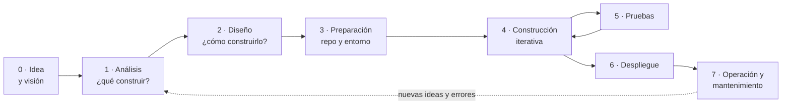

# 00 · Guía: cómo hacer un proyecto de software

**Proyecto de ejemplo:** Calida
**Versión:** 0.4 · **Fecha:** 18/11/2026 · **Estado:** viva (se completa fase por fase)
**Relacionados:** [01 · Diagrama de contexto](01-diagrama-de-contexto.md) · [02 · Casos de uso](02-casos-de-uso.md) · [03 · SRS](03-srs.md) · [04 · Arquitectura](04-arquitectura.md)

---

## 1. Cómo usar esta guía

Esta guía explica las fases de un proyecto de software en general, y cada idea se ilustra con lo que se hizo en Calida.

- La guía **crece a medida que el proyecto avanza**. Las fases ya vividas tienen detalle; las futuras solo tienen título y una línea.
- Cada fase usa la misma plantilla:
  - **¿Qué es?** — definición corta.
  - **¿Por qué importa?** — qué problema evita.
  - **Entregable** — qué existe al terminar.
  - **Cómo se hace** — pasos concretos.
  - **En Calida** — el ejemplo real.
  - **Errores comunes.**
  - **Lista para terminar** — cuándo se puede pasar a la siguiente fase.
- Al final hay **lecciones aprendidas** (errores reales del proyecto) y un **glosario**.

### Para qué existe Calida

Calida es un proyecto **para aprender** a construir sistemas web completos: React, Node, bases de datos, cómo se conecta el backend con el frontend, diseño de páginas, arquitectura y despliegue. No busca ser perfecto ni cumplir todas las exigencias de un sistema en producción. Por eso:

- Cuando dos opciones compiten, se prefiere la que **muestra cómo funciona algo por dentro** (principio 0 de [04 · Arquitectura](04-arquitectura.md)).
- La seguridad y la operación deben ser **suficientes y explicadas**: lo que se deja por fuera se escribe como decisión o como riesgo, para que sea una elección y no un olvido.
- Los temas técnicos nuevos (cookies, JWT…) se explican aparte, uno por documento, en la carpeta [`aprendizajes/`](../aprendizajes/README.md).

### Una idea antes de empezar

Programar un algoritmo y hacer un proyecto de software son problemas distintos:

| Algoritmo | Proyecto de software |
|---|---|
| El enunciado está dado y es preciso. | El enunciado no existe: hay que descubrirlo hablando con personas. |
| Lo difícil es la solución. | Lo difícil suele ser **decidir qué construir** y mantenerlo coherente en el tiempo. |
| Se termina cuando pasa los casos de prueba. | Nunca "se termina": se despliega, se usa, se corrige y cambia. |
| Una persona, un archivo. | Muchas piezas (base de datos, servidor, interfaz, servicios externos) que deben encajar. |

Casi todas las fases de esta guía existen para **reducir la incertidumbre antes de que escribir código la vuelva cara**. Cambiar una frase en el SRS cuesta un minuto; cambiar la misma decisión cuando ya hay base de datos, pantallas y usuarios cuesta días.

---

## 2. Mapa del ciclo de vida



Las flechas de vuelta son importantes: el proceso **no es una línea recta**. Construir y probar se repite muchas veces, y lo que se aprende en producción vuelve al análisis.

| Fase | Pregunta que responde | Entregable | Estado en Calida |
|---|---|---|---|
| 0 · Idea y visión | ¿Qué problema resolvemos y para quién? | Visión y alcance | ✅ (dentro de 01 y 03) |
| 1 · Análisis | ¿Qué debe hacer el sistema? | Contexto, casos de uso, SRS | ✅ 01, 02, 03 |
| 2 · Diseño | ¿Cómo lo vamos a construir? | Arquitectura, modelo de datos, diseño de pantallas | ✅ 04 (v0.3) y 05 (v0.3, con prototipo y dirección estética); falta probar el prototipo con usuarios |
| 3 · Preparación | ¿Dónde y con qué herramientas trabajamos? | Repositorio, entorno local, CI | 🔄 en curso (§6) |
| 4 · Construcción | Construir de a poco, una función completa a la vez | Código funcionando | ⏳ |
| 5 · Pruebas | ¿Funciona y sigue funcionando? | Pruebas automáticas | ⏳ |
| 6 · Despliegue | ¿Cómo llega a los usuarios? | Sistema en internet | ⏳ |
| 7 · Operación | ¿Cómo lo mantenemos vivo? | Monitoreo, respaldos, mejoras | ⏳ |

---

## 3. Fase 0 · Idea y visión

**¿Qué es?** Escribir en pocas líneas qué problema existe, a quién le duele y qué va a hacer (y qué **no** va a hacer) el sistema.

**¿Por qué importa?** Sin una visión clara, cada función nueva parece buena idea y el proyecto crece sin fin. La visión es el filtro para decir "no".

**Entregable:** un párrafo de propósito, la lista de usuarios y una lista de "dentro / fuera del alcance".

**Cómo se hace:**
1. Escribir el problema sin mencionar la solución. ("Las oportunidades de voluntariado en Cali están dispersas" y no "falta una app con mapa").
2. Nombrar a los usuarios concretos que tienen ese problema.
3. Definir la **primera versión mínima** (v1) que ya resuelve algo útil.
4. Escribir explícitamente lo que queda **fuera** de la v1.

**En Calida:** el propósito está en [03 · SRS §1.1](03-srs.md) y el alcance en [01 · §6 Límites del sistema](01-diagrama-de-contexto.md). La lista "fuera del alcance" (pagos, chat interno, certificación de horas, otras ciudades) es tan importante como la de "dentro": evita discusiones futuras.

**Errores comunes:**
- Describir la solución en lugar del problema.
- No escribir lo que queda fuera, y luego meterlo "porque es poquito".

**Lista para terminar:**
- [ ] Se puede explicar el proyecto en dos frases.
- [ ] Hay una lista de lo que queda fuera de la v1.

---

## 4. Fase 1 · Análisis: ¿qué debe hacer el sistema?

El análisis traduce la idea en algo **verificable**. Se mira el sistema desde afuera, como una caja negra: todavía no importa con qué tecnología se hará. En Calida produjo tres documentos, cada uno con más detalle que el anterior.

### 4.1 Diagrama de contexto

**¿Qué es?** Un dibujo del sistema como una sola caja, rodeado de las personas (**actores**) y los sistemas externos que se comunican con él, con flechas que dicen qué información viaja.

**¿Por qué importa?** Marca la **frontera** del sistema: qué construimos nosotros y qué usamos de otros. Descubre dependencias temprano (por ejemplo, "necesitamos un servicio de mapas").

**Entregable:** un diagrama y una tabla de actores y sistemas externos.

**Cómo se hace:**
1. Dibujar una caja en el centro con el nombre del sistema.
2. Preguntar "¿quién usa esto?" y poner cada tipo de usuario alrededor.
3. Preguntar "¿qué servicios de terceros necesitamos?" (correo, mapas, pagos…).
4. Etiquetar cada flecha con la información que viaja, no con la acción técnica.

**En Calida:** [01 · Diagrama de contexto](01-diagrama-de-contexto.md). Hay 5 actores (organización, ciudadano, voluntario, visitante, administrador) y 3 sistemas externos (mapas, fotos y WhatsApp). Nota que WhatsApp aparece con flecha punteada: es un canal **fuera** del sistema; Calida solo muestra el enlace.

**Errores comunes:**
- Dibujar componentes internos (base de datos, servidor). Eso es arquitectura, no contexto.
- Olvidar actores "invisibles", como el administrador o el visitante sin cuenta.

**Lista para terminar:**
- [ ] Cada actor y sistema externo tiene al menos una flecha.
- [ ] Está escrito qué queda fuera del sistema.

### 4.2 Casos de uso

**¿Qué es?** Cada caso de uso describe **un objetivo de un actor** y la conversación paso a paso entre el actor y el sistema para lograrlo, incluyendo qué pasa cuando algo sale mal.

**¿Por qué importa?** Obliga a pensar en flujos completos y en los errores. Más adelante, cada caso de uso se convierte en una unidad de trabajo y en una prueba.

**Entregable:** una lista de casos de uso (UC-01, UC-02…) y la ficha de cada uno.

**Cómo se hace:** para cada actor, listar lo que quiere lograr, y para cada objetivo escribir:
- **Actor principal.**
- **Precondición:** qué debe ser cierto antes.
- **Flujo principal:** pasos numerados del camino feliz.
- **Flujos alternativos:** qué pasa si falla un paso concreto (se referencia el número de paso).
- **Postcondición:** qué es cierto al terminar.

**En Calida:** [02 · Casos de uso](02-casos-de-uso.md), con 16 casos. Por ejemplo, UC-09 *Inscribirse a una necesidad* tiene dos flujos alternativos (ya inscrito, cantidad mayor al cupo). Esos dos flujos se convirtieron después en reglas de negocio (RN-07, RN-08) y en una decisión de arquitectura (bloquear la fila con `FOR UPDATE` para que dos personas no tomen el último cupo).

> **Conexión con algoritmos:** los flujos alternativos son los *casos borde* de un problema. Igual que en un algoritmo, ahí están los errores.

**Errores comunes:**
- Escribir detalles de interfaz ("hace clic en el botón azul"). El caso de uso describe intención, no diseño.
- Solo escribir el camino feliz.
- Casos demasiado pequeños ("escribir el título") o demasiado grandes ("usar la plataforma").

**Lista para terminar:**
- [ ] Cada actor del diagrama de contexto tiene al menos un caso de uso.
- [ ] Cada caso tiene precondición, postcondición y flujos alternativos.

### 4.3 Especificación de requisitos (SRS)

**¿Qué es?** El documento que reúne **todo lo que el sistema debe cumplir**, en frases verificables con un identificador. Se basa en el estándar IEEE 830.

**¿Por qué importa?** Es el contrato del proyecto: lo que no está aquí no se construye, y lo que está aquí se puede probar. Los identificadores permiten rastrear un requisito desde el documento hasta el código y la prueba.

**Entregable:** el SRS, con estos tipos de contenido:

| Tipo | Qué describe | Ejemplo en Calida |
|---|---|---|
| **Requisito funcional (RF)** | Algo que el sistema **hace**. | RF-005: iniciar y cerrar sesión con correo y contraseña. |
| **Requisito no funcional (RNF)** | **Qué tan bien** lo hace: rendimiento, seguridad, disponibilidad. | RNF-001: el listado carga en menos de 3 s en 4G con 500 iniciativas. |
| **Regla de negocio (RN)** | Una ley del dominio que se cumple siempre, sin importar la pantalla. | RN-04: el contacto es un enlace de WhatsApp o un celular de 10 dígitos que empieza por 3. |
| **Modelo de datos conceptual** | Qué cosas existen y cómo se relacionan, sin tablas todavía. | Iniciativa → tiene → Necesidades. |
| **Preguntas abiertas** | Lo que aún no se ha decidido. | [03 · §8](03-srs.md). |

**Cómo se hace:**
1. Recorrer cada caso de uso y escribir los RF que necesita. Anotar el UC de origen.
2. Priorizar con **MoSCoW**: *Must* (obligatorio), *Should* (deseable), *Could* (opcional), *Won't* (no en esta versión).
3. Escribir los RNF con **números medibles**. "Rápido" no se puede probar; "menos de 3 segundos" sí.
4. Sacar las reglas de negocio a una tabla propia, porque varias pantallas las usan.
5. Anotar las dudas como preguntas abiertas, en lugar de inventar una respuesta.

**En Calida:** [03 · SRS](03-srs.md). Cada RF tiene prioridad y el caso de uso de donde sale (columna "Caso de uso"). Eso es **trazabilidad**: si UC-09 cambia, se sabe qué requisitos revisar.

**Errores comunes:**
- Requisitos vagos o imposibles de verificar ("el sistema debe ser fácil de usar").
- Mezclar el *qué* con el *cómo* ("guardar en una tabla de PostgreSQL"). La tecnología se decide en el diseño.
- Todo con prioridad *Must*: entonces nada es prioridad.

**Lista para terminar:**
- [ ] Cada RF tiene ID, prioridad y caso de uso de origen.
- [ ] Cada RNF tiene un número medible.
- [ ] Las preguntas abiertas están escritas.
- [ ] Otra persona lo leyó y entendió lo mismo.

---

## 5. Fase 2 · Diseño: ¿cómo lo vamos a construir?

En el análisis el sistema era una caja negra. En el diseño **se abre la caja**: se decide qué piezas tiene por dentro, con qué tecnología, dónde viven los datos y quién puede tocarlos. Ahora sí importa la tecnología.

El diseño tiene tres partes. En Calida, las dos primeras están en [04 · Arquitectura](04-arquitectura.md) y la tercera en [05 · Diseño de pantallas](05-diseno-de-pantallas.md):

| Parte | Pregunta | Estado en Calida |
|---|---|---|
| 5.1 Arquitectura | ¿Qué piezas hay y cómo se comunican? | ✅ 04 v0.3 (ADR-01 a ADR-27; ver [L-03](#l-03--el-objetivo-del-proyecto-también-es-un-requisito)) |
| 5.2 Modelo de datos | ¿Qué tablas hay y qué reglas cumplen? | ✅ 04 §6 y `compartido/contratos.js` |
| 5.3 Diseño de pantallas | ¿Cómo se ve y se usa? | ✅ 05 v0.3: inventario, navegación, bocetos, guía visual, dirección estética y [prototipo](prototipo/README.md) |

### 5.1 Arquitectura

**¿Qué es?** La forma de alto nivel del sistema: sus componentes, sus responsabilidades, cómo se comunican y las decisiones técnicas importantes con su justificación.

**¿Por qué importa?** Las decisiones de arquitectura son las **más caras de cambiar** después. Cambiar el color de un botón es trivial; cambiar de base de datos con el sistema construido es casi rehacerlo. Por eso se piensan antes y se escriben.

**Entregable:** un documento con estos elementos:

| Elemento | Qué responde | En Calida |
|---|---|---|
| **Principios** | ¿Qué valoramos cuando dos opciones compiten? | 04 §2: aprender, simplicidad, defensa en dos lugares, mobile-first, costo cero. |
| **Vista de contenedores** | ¿Qué programas o servicios corren y cómo se hablan? | 04 §3: interfaz React, API Express, PostgreSQL, OpenStreetMap, Cloudinary. |
| **Responsabilidades** | ¿Qué hace cada pieza y qué **no** hace? | 04 §3.1. |
| **Stack tecnológico** | ¿Qué lenguajes, frameworks y servicios usamos? | 04 §4. |
| **Capas y módulos** | ¿Cómo se organiza el código por dentro? | 04 §5, con la lista de rutas de la API en §5.2. |
| **Seguridad** | ¿Quién puede hacer qué y cómo se garantiza? | 04 §7. |
| **Flujos principales** | ¿Qué pasa por dentro en los casos de uso críticos? | 04 §8: diagramas de secuencia de UC-09 y UC-03. |
| **Despliegue y entornos** | ¿Dónde corre y cómo llega un cambio a producción? | 04 §11. |
| **Riesgos** | ¿Qué puede salir mal por culpa de nuestras decisiones? | 04 §12. |
| **Decisiones (ADR)** | ¿Qué elegimos, frente a qué y por qué? | 04 §13. |

**Cómo se hace:**
1. **Partir de los requisitos no funcionales.** Los RNF son los que más fuerzan la arquitectura. "Funciona" lo cumple casi cualquier diseño; "carga en menos de 3 s con 500 iniciativas" (RNF-001) descarta algunos.
2. **Escribir principios** antes de elegir tecnología. Sirven para desempatar.
3. **Dibujar los contenedores** y decir qué hace y qué no hace cada uno.
4. **Elegir el stack** con criterios concretos: lo que el equipo conoce, el costo, lo que el servicio ya resuelve.
5. **Organizar el código en capas** (ver abajo).
6. **Recorrer los casos de uso críticos** con diagramas de secuencia para comprobar que las piezas alcanzan.
7. **Registrar cada decisión importante como ADR.**
8. **Listar los riesgos** que las decisiones crean y cómo mitigarlos.

#### Tres ideas clave del diseño de Calida

**a) Monolito modular, no microservicios (ADR-09, ADR-16).**
Un *monolito* es un solo programa que se despliega entero. Los *microservicios* son muchos programas pequeños que se hablan por red. Los microservicios resuelven problemas de organizaciones grandes (muchos equipos que despliegan por separado) y traen costos nuevos: fallos de red, despliegues coordinados, depuración distribuida. Para una persona o un equipo pequeño, un monolito **bien dividido en módulos** (cuentas, iniciativas, inscripciones…) es la elección correcta. Si algún día hace falta, un módulo bien separado se puede extraer.

En Calida hay **dos programas**: la interfaz (React, corre en el navegador) y la API (Express, corre en un servidor). Eso no es microservicios: la API sigue siendo un solo monolito modular. Separar interfaz y API es la división más común en la web, y hace visible cómo se hablan: peticiones HTTP que van y respuestas JSON que vuelven.

**b) Capas: cada una depende solo de la de abajo (04 §5).**

```
Presentación   → pantallas y formularios
Aplicación     → recibe la petición, valida, coordina
Dominio        → reglas de negocio puras (RN-01 a RN-13)
Acceso a datos → consultas SQL a PostgreSQL
```

La capa de **dominio** se escribe como **funciones puras**: reciben datos y devuelven un resultado o un error, sin tocar la base de datos ni la pantalla.

> **Conexión con algoritmos:** una regla como "la cantidad no puede superar el cupo" es una función `f(entrada) → salida`, igual que un ejercicio de algoritmos. Al aislarla, se prueba con casos de prueba normales, sin levantar navegador ni base de datos.

**c) Defensa en profundidad: nunca confiar en el cliente (ADR-19, ADR-21).**
Una regla de seguridad puesta solo en la interfaz se salta fácil: cualquiera puede mandar una petición directa sin usar tus pantallas (por ejemplo, con `curl`). Por eso Calida valida en **tres lugares**:

| Lugar | Para qué | Ejemplo |
|---|---|---|
| Formulario (React) | Comodidad: avisar rápido al usuario. | "El título es muy corto". |
| API (Zod y permisos) | Seguridad: no confiar en lo que llega. | Rechazar datos mal formados. Un voluntario solo puede leer **sus** inscripciones. |
| Base de datos (`check`, `unique`, llaves foráneas) | Última barrera: se cumple aunque la API tenga un error. | Ninguna necesidad puede tener más confirmados que su objetivo. |

Existe una cuarta opción que Calida conoció y descartó: *Row Level Security* (RLS), reglas que PostgreSQL evalúa **fila por fila** en cada consulta. Es muy segura, pero esconde los permisos dentro de la base. Para aprender se prefirió escribirlos en la API, donde se leen junto al resto del código (ADR-19 reemplaza a ADR-03).

Las operaciones donde dos personas compiten por lo mismo (el último cupo de una necesidad) se hacen dentro de una **transacción** que bloquea la fila (`SELECT … FOR UPDATE`). Es el mismo problema de *condición de carrera* que en programación concurrente: sin bloqueo, dos voluntarios leen "queda 1 cupo" al mismo tiempo y ambos se inscriben.

#### ADR: registro de decisiones

Un **ADR** (*Architecture Decision Record*) es una ficha corta por decisión:

| Campo | Contenido |
|---|---|
| Decisión | Lo que se eligió. |
| Alternativas | Lo que se consideró y no se eligió. |
| Motivo | Por qué, en el contexto de este momento. |

**Posponer también es una decisión.** No todo se resuelve en v1. Si algo se deja para después, se escribe como ADR con tres cosas: por qué el riesgo es aceptable hoy, qué señal indica que hay que hacerlo y cuál sería la solución. En Calida, ADR-22 pospone el correo: sin él no hay verificación de cuenta ni recuperación de contraseña. Hoy el riesgo se acepta porque no hay usuarios reales; la señal para hacerlo es tener usuarios, y la solución es un servicio de correo gratuito con un token temporal. Lo que separa una **decisión consciente** de un olvido es que está escrita.

Lo más valioso es el **motivo**. Dentro de seis meses alguien (tú mismo) preguntará "¿por qué no usamos TypeScript?". Sin el ADR-04, la decisión parece un error; con él, se ve que fue una elección y se puede revisar si el contexto cambió.

**Errores comunes:**
- **Elegir tecnología por moda** o antes de conocer los requisitos.
- **Diseñar para millones de usuarios** cuando aún no hay ninguno. Calida elige planes gratuitos y escribe en los riesgos cuándo habría que cambiar.
- **No escribir lo que cada pieza *no* hace.** Así aparecen responsabilidades duplicadas.
- **Confiar en el cliente** para la seguridad.
- **Decidir sin dejar rastro:** sin ADR, la misma discusión se repite.
- **Olvidar el objetivo del proyecto:** una herramienta que "te lo resuelve todo" es buena para entregar rápido, pero mala si lo que quieres es aprender justo lo que resuelve (ver L-03).

**Lista para terminar:**
- [ ] Cada RNF tiene al menos una decisión de arquitectura que lo atiende.
- [ ] Cada contenedor tiene responsabilidades y "no hace".
- [ ] Los casos de uso críticos tienen un diagrama de secuencia.
- [ ] Cada decisión importante tiene un ADR.
- [x] Los pendientes técnicos están resueltos o pospuestos con un ADR (en Calida: 04 §14).

### 5.2 Modelo de datos

**¿Qué es?** La traducción del modelo conceptual del SRS (entidades y relaciones) a **tablas reales**, con tipos, llaves, restricciones e índices.

**¿Por qué importa?** Los datos duran más que el código. Las pantallas se rehacen; los datos de los usuarios se quedan. Un modelo bien hecho hace que muchas reglas se cumplan solas.

**Cómo se hace:**
1. Cada entidad del modelo conceptual se vuelve una tabla; cada atributo, una columna con su tipo.
2. Cada relación se vuelve una **llave foránea** (uno a muchos) o una **tabla intermedia** (muchos a muchos).
3. Cada regla de negocio que se pueda expresar como restricción, se escribe en la tabla (`not null`, `check`, `unique`).
4. Los valores fijos y conocidos se modelan como **enum**; los que un administrador debe poder cambiar, como **tabla de catálogo**.
5. Se agregan **índices** para las consultas frecuentes (mirando los casos de uso).

**En Calida** ([04 §6](04-arquitectura.md)), se ve cómo las reglas del SRS bajan a la base de datos:

| Regla | Dónde quedó |
|---|---|
| La contraseña nunca se guarda en texto plano | Tabla `usuarios` con `hash_contrasena` (bcrypt), separada de `perfiles`. |
| RN-04: contacto de WhatsApp o celular válido | `check` con expresión regular en `iniciativas.medio_contacto`. |
| RN-05: título de máximo 120 caracteres | `check (char_length(titulo) between 5 and 120)`. |
| RN-07: no superar el cupo | `check (cantidad_confirmada <= cantidad_objetivo)` en `necesidades`. |
| RN-08: no inscribirse dos veces | `unique (necesidad_id, voluntario_id)` en `inscripciones`. |
| Tipos de ayuda administrables | Tabla `tipos_ayuda` en vez de enum. |
| Una iniciativa tiene varios tipos de ayuda | Tabla intermedia `iniciativa_tipos_ayuda`. |
| Buscar iniciativas en el área del mapa | Índice `GIST(ubicacion)` con PostGIS. |

> **Conexión con algoritmos:** un índice es una estructura de datos (un árbol B, o un R-tree en el caso de `GIST` para coordenadas) que convierte una búsqueda lineal en una logarítmica. Lo eliges como eliges la estructura de datos de un algoritmo: según las consultas que vas a hacer.

**Errores comunes:**
- Poner las reglas solo en el código y dejar la tabla "abierta".
- Guardar listas en una columna de texto en vez de usar una tabla relacionada.
- Usar un enum para algo que el negocio va a querer cambiar.
- Modificar la base de producción a mano. Los cambios se escriben como **migraciones** versionadas (04 §11.2).

**Lista para terminar:**
- [ ] Cada entidad del SRS tiene su tabla.
- [ ] Cada regla de negocio expresable como restricción está en la tabla.
- [ ] Cada consulta frecuente tiene un índice que la soporta.
- [x] El código existente coincide con el modelo (en Calida: [L-01](#l-01--los-documentos-y-el-código-se-desalinean), resuelto).

### 5.3 Diseño de pantallas

**¿Qué es?** Decidir **qué pantallas** tiene el sistema, **cómo se pasa** de una a otra, **qué contiene** cada una y **cómo se ve** todo (colores, letra, componentes). Se hace antes de programar la interfaz.

**¿Por qué importa?** Mover una caja en un boceto toma un minuto; cambiar un componente de React con estado, rutas y llamadas a la API toma horas. Además, el diseño revela huecos del análisis: al dibujar el detalle aparece la pregunta "¿y si la iniciativa está cancelada?", que debe tener respuesta.

**Cómo se hace** (de lo general a lo particular, de baja a alta fidelidad):
1. **Inventario:** una pantalla por cada objetivo de los casos de uso, con su ruta. Se cruza con los casos de uso para que ninguno quede sin pantalla.
2. **Navegación:** el menú de cada rol y un mapa de cómo se llega a cada pantalla.
3. **Bocetos de baja fidelidad** (*wireframes*): cajas y textos, sin colores. Primero el móvil (*mobile-first*), porque obliga a priorizar; el escritorio se deriva después.
4. **Estados** de cada pantalla: cargando, vacío, error y sin permiso. Son la mitad del trabajo y lo que más se olvida.
5. **Guía visual:** colores con nombre (*tokens*), tipografía, espacios y la lista de componentes reutilizables.
6. **Prototipo de alta fidelidad** de pocas pantallas clave, para ver el resultado real antes de construir todas.

**En Calida** ([05](05-diseno-de-pantallas.md)):

| Paso | Dónde quedó |
|---|---|
| Inventario | 18 pantallas (PT-01 a PT-18); los 16 casos de uso tienen pantalla. |
| RNF-013: inscribirse en 3 pasos | Hoja inferior dentro del detalle (DP-03): Quiero participar → cantidad → Confirmar. |
| RNF-014: accesibilidad AA | Contrastes calculados para cada color y lista de revisión (05 §6). |
| La estética del usuario | Logo 3 y collage; vino `#661427` sacado del SVG del logo. |

> **Conexión con la fórmula:** el contraste de WCAG no es una opinión. Se calcula: `(L1 + 0.05) / (L2 + 0.05)`, donde L es la luminancia relativa de cada color (una suma ponderada de rojo, verde y azul, porque el ojo es más sensible al verde). Al calcularlo apareció una sorpresa: los colores vivos del collage (azul, amarillo, salvia) **no se pueden usar para texto** sobre blanco. Por eso son decorativos y, cuando hace falta texto, se usan pares de tinte claro con tinta oscura.

**Errores comunes:**
- Diseñar solo el camino feliz: la pantalla con datos perfectos y nada más.
- Empezar por el escritorio y "encoger" después: en móvil todo queda apretado.
- Elegir colores a ojo, sin medir el contraste.
- Usar solo color para dar información (rojo = rechazada) sin texto o ícono.
- Pulir colores y sombras antes de acordar qué va en cada pantalla.

**Lista para terminar:**
- [x] Cada caso de uso tiene al menos una pantalla.
- [x] Cada pantalla tiene ruta, rol que la ve y endpoint de la API.
- [x] Los flujos críticos tienen boceto con sus estados (cargando, vacío, error).
- [x] Colores, tipografía y componentes definidos, con el contraste verificado.
- [x] Prototipo de alta fidelidad de las pantallas clave ([`prototipo/`](prototipo/README.md)).
- [ ] Bocetos probados con 2 o 3 personas.

---

## 6. Fase 3 · Preparación del entorno

**¿Qué es?** Dejar listo el lugar donde se va a construir: la estructura de carpetas, las herramientas, la base de datos local, las reglas para trabajar con Git y una revisión automática en cada cambio. Todavía **no** se construye ninguna función del sistema.

**¿Por qué importa?** Si cada persona instala versiones distintas, nombra las ramas a su manera o descubre que "en mi computador sí funciona", el tiempo se va en problemas que no tienen nada que ver con Calida. Preparar el entorno una vez, y escribirlo, hace que cualquiera pueda clonar el repositorio y tener el sistema corriendo en minutos.

**Entregable:**
- Un repositorio con la estructura de [04 §5.3](04-arquitectura.md) y un `README.md` que explica cómo arrancarlo.
- Un **esqueleto caminante** (*walking skeleton*): la versión más delgada posible del sistema completo, con todas sus piezas conectadas pero sin funciones reales. En Calida: la pantalla de React le pide a la API su estado, la API le pregunta a la base de datos, y la respuesta llega de vuelta a la pantalla.
- Lint, formato y una revisión automática (CI) que corre en cada Pull Request.

**Cómo se hace:**
1. **Acordar las convenciones de Git** antes de que haya código: cómo se nombran las ramas, cómo se escriben los commits y cómo entra un cambio a `main`.
2. **Fijar las versiones** de las herramientas (Node, PostgreSQL), para que todos usen las mismas.
3. **Crear la estructura de carpetas** decidida en el diseño. No hay que inventarla otra vez: ya está en la arquitectura.
4. **Levantar la base de datos local** con Docker, para no instalar PostgreSQL a mano en cada computador.
5. **Conectar las piezas de punta a punta** con el caso más simple posible (el esqueleto caminante).
6. **Agregar las herramientas de calidad:** un *linter* (encuentra errores probables) y un formateador (ordena el estilo del código solo).
7. **Automatizar la revisión** con integración continua (CI): un servidor que, en cada Pull Request, instala todo y corre el lint (y más adelante las pruebas).
8. **Escribir el `README.md`** con los pasos para arrancar, y probarlos desde un clon limpio.

> **¿Por qué un esqueleto y no la primera función?** Porque conectar React, Express y PostgreSQL tiene sus propios problemas (puertos, el *proxy*, variables de entorno, la conexión a la base). Si aparecen junto con la lógica de las iniciativas, no se sabe si el error está en la conexión o en la función. Con el esqueleto se resuelven primero y por separado. Es lo mismo que probar un algoritmo con un caso pequeño antes que con el grande.

**En Calida:** casi todo ya se decidió en el diseño ([04 §4](04-arquitectura.md) stack, [§5.3](04-arquitectura.md) carpetas, [§11](04-arquitectura.md) entornos). Esta fase lo vuelve real, paso por paso:

| Paso | Qué se hace | Qué se aprende | Estado |
|---|---|---|---|
| 1 | Convenciones de Git en [`CONTRIBUTING.md`](../CONTRIBUTING.md): ramas `tipo/descripcion`, commits en español con verbo en infinitivo ("Agregar…", "Corregir…"), todo entra a `main` por Pull Request con "Squash and merge". Plantilla de PR en `.github/`. | Flujo de trabajo en equipo. | ✅ |
| 2 | Node 24 (LTS) fijado en `.nvmrc` (para `nvm use`) y en `engines` del `package.json`; `.npmrc` con `engine-strict=true` hace que `npm install` falle con otra versión. | Por qué se fijan las versiones. | ✅ |
| 3 | Monorepo con npm workspaces: `compartido/` (con `contratos.js`, antes en `lib/`), `backend/` (Express 5, `node --watch`) y `frontend/` (React 19 + Vite 8, con proxy `/api` → puerto 3000). `npm run dev` en la raíz levanta los dos. | Qué es un paquete de npm y un *workspace*. | ✅ |
| 4 | `docker-compose.yml` con PostgreSQL + PostGIS, `.env.example` y el script de migraciones. | Contenedores, variables de entorno, migraciones. | ⏳ |
| 5 | Esqueleto caminante: `GET /api/salud` consulta la base y la pantalla de React muestra "API y base conectadas". | El *proxy* de Vite y el viaje completo de una petición. | ⏳ |
| 6 | Los tokens de `prototipo/tema.js` pasan a `frontend/src/index.css`, con la dirección estética de [05 §5.7](05-diseno-de-pantallas.md). | Tailwind compilado con Vite. | ⏳ |
| 7 | ESLint y Prettier, con los scripts `npm run lint` y `npm run formato`. | Calidad automática del código. | ⏳ |
| 8 | GitHub Actions: en cada Pull Request se instala todo y se corre el lint. | Integración continua. | ⏳ |
| 9 | `README.md` de la raíz, probado desde un clon limpio. | Documentar para otra persona. | ⏳ |

**Pendiente de hablar con el equipo:** en GitHub existe la rama `dev1/modulo-publico` (7/11/2026), hecha con Next.js y TypeScript, es decir, con la arquitectura anterior a ADR-16 y ADR-04. Antes del paso 3 hay que acordar con su autor qué se hace con ella: se puede aprovechar su contenido (pantallas y datos de ejemplo) en la estructura nueva, pero no unirla tal cual. Es otro caso de [L-01](#l-01--los-documentos-y-el-código-se-desalinean).

**Errores comunes:**
- Construir la primera función sin haber conectado antes las piezas: los errores de configuración se mezclan con los de la lógica.
- Subir al repositorio el archivo `.env` con contraseñas. Al repositorio solo va `.env.example`, sin valores reales.
- "Funciona en mi computador": versiones distintas de Node o de PostgreSQL entre personas.
- Dejar el `README` para el final y que nadie más sepa arrancar el proyecto.
- Configurar demasiadas herramientas "por si acaso". Cada herramienta debe resolver un problema que ya existe.

**Lista para terminar:**
- [ ] Las convenciones de Git están escritas y el equipo las conoce.
- [ ] `npm install` y `npm run dev` levantan la interfaz y la API; `docker compose up` levanta la base.
- [ ] El esqueleto caminante funciona: la pantalla muestra datos que vinieron de la base.
- [ ] `npm run lint` pasa, y GitHub Actions lo corre en cada Pull Request.
- [ ] Otra persona clonó el repositorio y lo arrancó siguiendo solo el `README`.

## 7. Fase 4 · Construcción iterativa

> ⏳ Se completa cuando lleguemos aquí.

Construir el sistema en **rebanadas verticales**: un caso de uso completo a la vez, desde la base de datos hasta la pantalla, en lugar de capa por capa.

## 8. Fase 5 · Pruebas

> ⏳ Se completa cuando lleguemos aquí.

Pruebas automáticas que verifican requisitos y reglas de negocio, y que se ejecutan en cada cambio.

## 9. Fase 6 · Despliegue

> ⏳ Se completa cuando lleguemos aquí.

Publicar el sistema en internet con entornos separados (local, pruebas, producción).

## 10. Fase 7 · Operación y mantenimiento

> ⏳ Se completa cuando lleguemos aquí.

Monitorear errores, hacer respaldos, atender reportes y planear la siguiente versión.

---

## 11. Lecciones aprendidas

Errores y descubrimientos reales del proyecto. Se agregan a medida que aparecen.

### L-01 · Los documentos y el código se desalinean

**Qué pasó:** el primer archivo de código, `src/types/contratos.ts`, se escribió antes de cerrar el análisis. Después, los documentos cambiaron y el archivo quedó contradiciendo a los documentos:

| Tema | `contratos.ts` | Documentos actuales |
|---|---|---|
| Inscripción | Sin cuenta (`SolicitudParticipacion` pide nombre y correo). | Requiere cuenta de voluntario (RF-010, UC-09). |
| Estados de iniciativa | 8 estados. | 10 estados (ADR-07 agrega `pendiente_revision` y `rechazada`). |
| Lenguaje | TypeScript. | JavaScript (ADR-04). |
| Tipos de ayuda | Lista fija de 3. | Tabla administrable. |

**Lección:**
- Escribir código antes de cerrar el análisis no está prohibido (a veces ayuda a pensar), pero hay que tratarlo como **borrador desechable**.
- Cada decisión debe tener **una sola fuente de verdad**. Cuando una decisión cambia, se revisa todo lo que depende de ella.
- Los identificadores (UC, RF, RN, ADR) hacen posible esa revisión: se busca el ID y se ve qué toca.

**Resuelto en la fase 2:** `src/types/contratos.ts` se reemplazó por `lib/contratos.js` (en la fase 3 pasó a `compartido/contratos.js`), en JavaScript con JSDoc y alineado con el modelo de datos de [04 · §6](04-arquitectura.md). El archivo dice en su encabezado cuál es su fuente de verdad. También se encontró otra contradicción, esta vez entre dos documentos: el SRS (P-09) decía "se mantienen los 8 estados", mientras ADR-07 decía 10. Se corrigió el SRS.

### L-02 · Una decisión pequeña toca varios documentos

**Qué pasó:** en el diseño se decidió no calcular distancias (ADR-13). Parece una decisión solo técnica, pero buscando la palabra "distancia" apareció en tres lugares:

| Documento | Qué decía | Cómo quedó |
|---|---|---|
| 03 · SRS | RF-029: ordenar por distancia, prioridad *Could*. | Prioridad *Won't* (no en v1), con referencia a ADR-13. |
| 02 · Casos de uso | UC-07 A1: "permite ordenar por distancia". | Aclara que queda fuera de v1. |
| 04 · Arquitectura | Índice GIST "para ordenar por distancia". | Solo para el área del mapa. |

**Lección:** las decisiones de diseño pueden **cambiar los requisitos**, no solo al revés. Cuando se toma una decisión, se busca en todos los documentos lo que dependía de ella y se actualiza en el mismo momento. Bajar la prioridad a *Won't* en lugar de borrar el requisito deja constancia de que se pensó y se descartó a propósito.

### L-03 · El objetivo del proyecto también es un requisito

**Qué pasó:** la arquitectura 0.2 eligió Next.js + Supabase, porque Supabase ya trae login, base de datos, permisos (RLS), fotos y avisos en tiempo real. Para entregar rápido era una buena decisión. Pero el objetivo real del proyecto es **aprender** React, Node, bases de datos y cómo se conecta el frontend con el backend, y Supabase escondía casi todo eso. Al revisarlo, la arquitectura cambió a React + Express + PostgreSQL propio (ADR-16 a ADR-27).

El cambio tocó cinco documentos:

| Documento | Qué cambió |
|---|---|
| 04 · Arquitectura | Casi todo: contenedores, stack, seguridad, despliegue y 12 ADR nuevas. |
| 03 · SRS | RNF-004, 007, 008 y 021; RF-004 y RF-006 pasan a *Won't*; nueva entidad Usuario. |
| 02 · Casos de uso | UC-01 y UC-02 sin verificación ni recuperación por correo. |
| 01 · Contexto | Supabase deja de ser externo; aparece Cloudinary. |
| 00 · Guía | Esta lección y la sección 5.1. |

**Lección:**
- No hay decisiones técnicas "correctas" en abstracto: son correctas **para un objetivo**. Una decisión ideal para producción puede ser mala para aprender, y al revés.
- El objetivo del proyecto (entregar rápido, aprender, escalar, gastar poco) se escribe al inicio, junto a la visión, porque decide muchas cosas después. En Calida ahora está en §1 y en el principio 0.
- Las ADR viejas **no se borran**: se marcan como reemplazadas. Así queda el rastro de qué se pensó, por qué cambió y cuándo.
- Cambiar esto en la fase de diseño costó editar documentos. Con código ya escrito, habría costado rehacer el backend.

### L-04 · Una decisión puede anular la ventaja de otra

**Qué pasó:** la ADR-18 eligió JWT para las sesiones. La gracia de un JWT es que el servidor sabe quién eres **sin consultar la base**, porque el token viene firmado. Pero en la misma sección se decidió cargar el perfil desde la base en cada petición, para que una suspensión tuviera efecto inmediato (RN-09). Juntas, las dos decisiones pagaban el costo del JWT (una librería, un secreto que proteger, no poder cerrar sesión de verdad) sin recibir su beneficio. Al preguntar "¿qué es un JWT y por qué lo necesitamos?", apareció la contradicción y se cambió a sesiones guardadas en la base.

**Lección:**
- Para cada herramienta, preguntar **qué problema resuelve aquí**. Si otra decisión ya eliminó ese problema, la herramienta sobra.
- Hacer preguntas "básicas" sobre el diseño no es perder el tiempo: así se encuentran estas contradicciones antes de escribir código.
- Como la ADR-18 tenía horas y no había código, se corrigió en el mismo lugar, dejando escrita la fecha de la revisión. Si ya hubiera código, se escribiría una ADR nueva que la reemplace.

### L-05 · Una herramienta de diseño trae sus propias reglas

**Qué pasó:** para que el prototipo se viera más atractivo se probó la skill de diseño *taste*. Generó una página de presentación muy pulida, pero con sus propias reglas: cambió la fuente Poppins por otra, impuso "una sección por pantalla", agregó un fondo animado con WebGL, copió 38 MB de archivos al repositorio y necesitó un navegador y varias rondas de revisión. Además, la página nueva enlazaba a las pantallas del prototipo, y las dos versiones quedaron mezcladas. Se borró y el prototipo volvió a su forma sencilla.

**Lección:**
- Una herramienta que "lo hace todo" decide por ti. Antes de adoptarla, se compara con el objetivo del proyecto (aprender, simplicidad), igual que en [L-03](#l-03--el-objetivo-del-proyecto-también-es-un-requisito).
- Los experimentos se hacen **aparte** (en otra carpeta o en otra rama) y se evalúan antes de mezclarlos con lo que ya funciona.
- Lo que sí sirvió fue la lista de lo que hace que una página "parezca hecha por IA". Esa idea, sin la herramienta, quedó como dirección estética en [05 §5.7](05-diseno-de-pantallas.md) (DP-08).

---

## 12. Glosario
| Término | Significado |
|---|---|
| **Actor** | Persona o sistema externo que interactúa con el sistema. |
| **ADR** | *Architecture Decision Record*: ficha de una decisión, sus alternativas y su motivo. |
| **Alcance** | Lo que el sistema hará en una versión, y lo que no. |
| **API REST** | Forma de organizar un servidor: cada URL es un recurso (`/api/iniciativas`) y el método HTTP dice la acción (`GET` leer, `POST` crear, `PATCH` modificar, `DELETE` borrar). |
| **bcrypt** | Algoritmo para calcular el hash de contraseñas. Es lento a propósito, para que adivinar contraseñas cueste mucho. |
| **Camino feliz** | El flujo principal, cuando nada sale mal. |
| **CI (integración continua)** | Un servidor que, en cada cambio subido, instala el proyecto y corre el lint y las pruebas. Si algo falla, el cambio no entra a `main`. En Calida: GitHub Actions. |
| **Capa** | Nivel del código con una responsabilidad; solo depende del nivel de abajo. |
| **Caso de uso (UC)** | Objetivo de un actor y los pasos para lograrlo con el sistema. |
| **Condición de carrera** | Error que aparece cuando dos operaciones simultáneas leen y escriben el mismo dato. |
| **Contraste** | Diferencia de luminosidad entre el texto y su fondo. WCAG pide al menos 4.5:1 para texto normal. |
| **Contenedor** | Programa o servicio que corre por separado (navegador, servidor, base de datos). |
| **Cookie** | Dato pequeño que el servidor guarda en el navegador y que el navegador devuelve en cada petición. Con `HttpOnly`, JavaScript no puede leerla. |
| **CORS** | Mecanismo con el que un servidor permite peticiones desde otro origen (otro dominio o puerto). |
| **Docker** | Herramienta que corre programas dentro de *contenedores*: cajas aisladas con todo lo que el programa necesita. En Calida levanta PostgreSQL sin instalarlo en el computador. |
| **Dominio** | Capa con las reglas de negocio, sin depender de pantallas ni base de datos. |
| **Esqueleto caminante** | (*Walking skeleton*) La versión más delgada del sistema completo: todas las piezas conectadas de punta a punta, sin funciones reales todavía. |
| **Endpoint** | Una ruta concreta de la API, por ejemplo `POST /api/inscripciones`. |
| **Flujo alternativo** | Lo que pasa cuando un paso falla o hay una variante. |
| **Hash** | Resultado de una función que convierte un texto en otro, de forma que no se puede volver al original. Sirve para guardar contraseñas sin conocerlas. |
| **Índice** | Estructura de datos de la base que acelera una búsqueda. |
| **JSON** | Formato de texto para enviar datos entre la interfaz y la API. |
| **LTS** | *Long Term Support*: versión de un programa con arreglos de seguridad garantizados por varios años. Node saca una LTS cada octubre (las versiones pares). |
| **Linter** | Programa que lee el código sin ejecutarlo y avisa de errores probables (una variable que no existe, una que nunca se usa). En Calida: ESLint. |
| **JWT** | *JSON Web Token*: texto firmado por el servidor que dice quién es el usuario. Si alguien lo modifica, la firma deja de coincidir. Calida lo estudió y lo descartó (ver L-04). |
| **nvm** | *Node Version Manager*: instala varias versiones de Node y cambia entre ellas. `nvm use` lee la versión del archivo `.nvmrc`. |
| **Middleware** | Función que se ejecuta antes del controlador en cada petición, por ejemplo para revisar la sesión. |
| **Migración** | Archivo versionado con un cambio a la estructura de la base de datos. |
| **Mobile-first** | Diseñar primero para la pantalla del celular y después ampliar para el escritorio. |
| **Monolito modular** | Un solo programa desplegable, dividido internamente en módulos independientes. |
| **Monorepo** | Un solo repositorio con varios proyectos (aquí: frontend, backend y compartido). |
| **MoSCoW** | Método de prioridad: *Must*, *Should*, *Could*, *Won't*. |
| **MVP / v1** | Primera versión mínima que ya resuelve algo útil. |
| **Paquete (npm)** | Carpeta con un `package.json`: tiene nombre, versión y dependencias, y otros paquetes lo pueden importar. En Calida hay tres: `@calida/frontend`, `@calida/backend` y `@calida/compartido`. |
| **ORM** | Librería que traduce objetos del código a tablas y genera el SQL. Calida no usa uno, para aprender SQL directamente. |
| **Proxy / reescritura** | Un servidor que recibe una petición y la reenvía a otro. Calida lo usa para que la interfaz y la API parezcan un solo sitio. |
| **Rebanada vertical** | Una función completa, de base de datos a pantalla, construida de una vez. |
| **Regla de negocio (RN)** | Ley del dominio que se cumple siempre, sin importar la pantalla. |
| **Requisito funcional (RF)** | Algo que el sistema hace. |
| **Requisito no funcional (RNF)** | Qué tan bien lo hace: rendimiento, seguridad, disponibilidad. |
| **RLS** | *Row Level Security*: reglas de PostgreSQL que deciden, fila por fila, quién puede leer o escribir. |
| **Sesión** | Registro de que un usuario ya inició sesión. En Calida es una fila de la tabla `sesiones`; el navegador guarda su id en una cookie y lo envía en cada petición. |
| **SPA** | *Single Page Application*: la página se carga una vez y luego JavaScript cambia la pantalla y pide datos a la API, sin recargar. |
| **SRS** | *Software Requirements Specification*: documento de requisitos. |
| **Stack** | Conjunto de tecnologías elegidas para el proyecto. |
| **Transacción** | Grupo de operaciones que se aplican todas o ninguna. |
| **Token de diseño** | Nombre para un valor visual (por ejemplo `vino` = `#661427`). El código usa el nombre, así cambiar el color es cambiar una sola línea. |
| **Trazabilidad** | Poder seguir un requisito desde su origen hasta el código y la prueba. |
| **Variable de entorno** | Valor de configuración (como una contraseña de base de datos) que se le da al programa desde afuera, no escrito en el código. |
| **Workspaces (npm)** | Forma de tener varios paquetes de npm en un solo repositorio (`frontend`, `backend`, `compartido`) que se instalan juntos y pueden importarse entre sí. |
| **WCAG** | *Web Content Accessibility Guidelines*: reglas para que una página la pueda usar cualquier persona, incluso con baja visión o con lector de pantalla. Calida apunta al nivel AA (RNF-014). |
| **Wireframe (boceto)** | Dibujo simple de una pantalla, con cajas y textos, que muestra qué va y dónde, sin colores ni detalles. |
