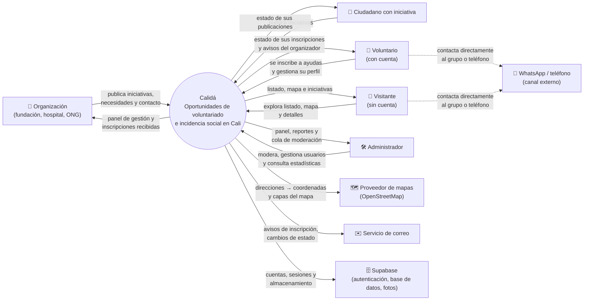

# 01 · Diagrama de contexto

**Proyecto:** Calidá
**Versión:** 0.2 · **Fecha:** 12/11/2026 · **Estado:** borrador

---

## 1. Propósito

Este diagrama muestra el sistema como una caja negra: quiénes interactúan con él, qué información intercambian y qué sistemas externos necesita para funcionar. No describe la arquitectura interna.

## 2. Diagrama

## 3. Actores

| Actor | Descripción | Cuenta | Qué hace con el sistema |
|---|---|---|---|
| **Organización** | Fundaciones, hospitales, ONG u otras entidades reconocidas que necesitan voluntarios, donaciones o transporte. | Sí | Publica y gestiona iniciativas, define necesidades y gestiona las inscripciones que recibe. |
| **Ciudadano con iniciativa** | Persona sin organización formal que quiere impulsar una actividad y necesita apoyo de otras personas. | Sí | Publica y gestiona sus iniciativas con las mismas funciones básicas de una organización. |
| **Voluntario** | Persona registrada que quiere apoyar una iniciativa. | Sí | Explora, se inscribe a necesidades, recibe avisos y consulta su historial. |
| **Visitante** | Persona que entra al sistema sin registrarse. | No | Explora el listado, el mapa y los detalles. No puede inscribirse ni reportar. |
| **Administrador** | Responsable de la plataforma. | Sí (rol interno) | Modera publicaciones, gestiona usuarios y consulta estadísticas. |

## 4. Sistemas externos

| Sistema externo | Intercambio | Motivo |
|---|---|---|
| Proveedor de mapas (OpenStreetMap con Leaflet) | El sistema envía direcciones y recibe coordenadas; carga las capas del mapa. | Visualizar las iniciativas en el mapa de Cali. |
| Servicio de correo | El sistema envía avisos de inscripción y de cambios de estado. | Notificar a organizadores y voluntarios. |
| Supabase | Autenticación (registro, sesiones, recuperación de contraseña), base de datos PostgreSQL y almacenamiento de fotos. | Backend del sistema. |
| WhatsApp / teléfono | Canal externo al sistema. Voluntarios y visitantes abren el enlace del grupo o marcan el número. | Contacto directo. El sistema no gestiona mensajes. |

## 5. Flujos de información principales

| Desde | Hacia | Información |
|---|---|---|
| Organización / Ciudadano | Sistema | Iniciativa (título, foto, descripción, fecha, lugar, ubicación, contacto, categoría, tipos de ayuda) y necesidades. |
| Voluntario | Sistema | Inscripción a una necesidad (cantidad y mensaje opcional), reportes y perfil. |
| Visitante | Sistema | Filtros de búsqueda y consultas al listado y al mapa. |
| Sistema | Visitante / Voluntario | Listado, mapa, detalle de iniciativas y medio de contacto público. |
| Sistema | Organización / Ciudadano | Nuevas inscripciones y cambios de estado de sus iniciativas. |
| Sistema | Administrador | Cola de moderación, reportes y estadísticas agregadas. |

## 6. Límites del sistema

**Dentro del alcance (v1):**
- Publicación, edición y gestión de iniciativas y necesidades.
- Exploración por listado y mapa, con filtros por categoría y tipo de ayuda.
- Inscripción de voluntarios registrados y notificaciones por correo.
- Moderación, gestión de usuarios y estadísticas para el administrador.

**Fuera del alcance (v1):**
- Donaciones monetarias o pasarelas de pago.
- Chat interno entre voluntarios y organizaciones (la comunicación se hace por WhatsApp o teléfono).
- Certificación o registro oficial de horas de voluntariado.
- Gestión de inventario de donaciones.
- Ciudades distintas a Cali.
