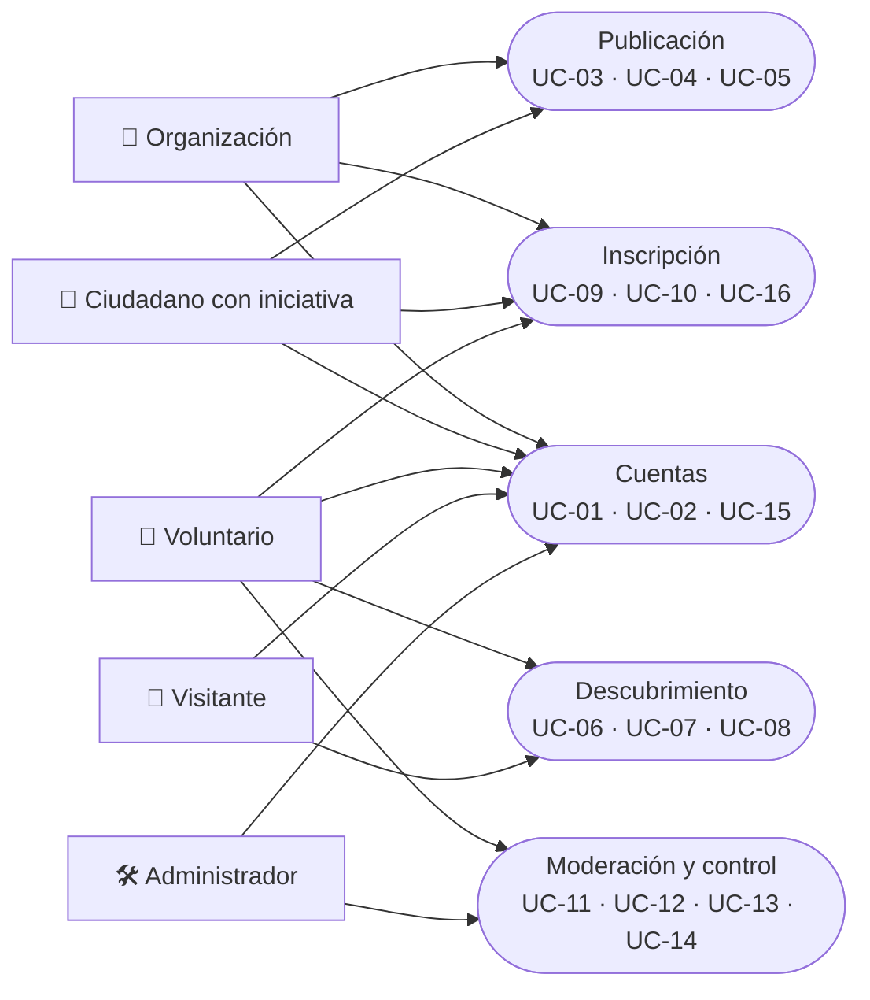

# 02 · Casos de uso

**Proyecto:** Calidá
**Versión:** 0.2 · **Fecha:** 12/11/2026 · **Estado:** borrador
**Relacionado:** [01 · Diagrama de contexto](01-diagrama-de-contexto.md) · [03 · SRS](03-srs.md)

---

## 1. Vista general

> Nota: el visitante solo puede ejecutar UC-06, UC-07 y UC-08, y puede registrarse con UC-01. Las acciones de inscripción y reporte requieren cuenta.

## 2. Resumen

| ID | Caso de uso | Actor principal | Prioridad |
|---|---|---|---|
| UC-01 | Registrarse | Organización, Ciudadano con iniciativa, Voluntario, Visitante | Alta |
| UC-02 | Iniciar sesión y recuperar contraseña | Organización, Ciudadano, Voluntario, Administrador | Alta |
| UC-03 | Publicar iniciativa | Organización, Ciudadano con iniciativa | Alta |
| UC-04 | Gestionar necesidades de una iniciativa | Organización, Ciudadano con iniciativa | Alta |
| UC-05 | Editar o cambiar estado de una iniciativa | Organización, Ciudadano con iniciativa | Alta |
| UC-06 | Explorar iniciativas (listado y filtros) | Visitante, Voluntario | Alta |
| UC-07 | Ver iniciativas en el mapa | Visitante, Voluntario | Alta |
| UC-08 | Ver detalle de una iniciativa | Visitante, Voluntario | Alta |
| UC-09 | Inscribirse a una necesidad | Voluntario | Alta |
| UC-10 | Gestionar inscripciones recibidas | Organización, Ciudadano con iniciativa | Alta |
| UC-11 | Reportar iniciativa | Voluntario | Media |
| UC-12 | Moderar iniciativas | Administrador | Alta |
| UC-13 | Gestionar usuarios | Administrador | Media |
| UC-14 | Consultar estadísticas | Administrador | Alta |
| UC-15 | Editar perfil propio | Organización, Ciudadano con iniciativa, Voluntario | Media |
| UC-16 | Consultar historial de inscripciones | Voluntario | Media |

---

## 3. Detalle de casos de uso

### UC-01 · Registrarse

- **Actor principal:** Organización, Ciudadano con iniciativa o Voluntario. Un visitante puede iniciar este caso para convertirse en voluntario.
- **Precondición:** El visitante no tiene sesión iniciada.
- **Postcondición:** Cuenta creada con rol asignado y correo verificado.

**Flujo principal**
1. El visitante elige el tipo de cuenta: *Organización*, *Ciudadano con iniciativa* o *Voluntario*.
2. Completa nombre, correo y contraseña. Según el tipo, agrega: ciudad y descripción (organización) o teléfono opcional (ciudadano y voluntario).
3. Acepta el aviso de privacidad y el tratamiento de datos.
4. El sistema valida los datos y verifica que el correo no esté registrado.
5. El sistema crea la cuenta y envía un correo de verificación.
6. El usuario confirma su correo desde el enlace recibido.

**Flujos alternativos**
- **A1 (paso 4):** El correo ya existe → el sistema ofrece iniciar sesión o recuperar contraseña.
- **A2 (paso 3):** No acepta el aviso → no se crea la cuenta.

---

### UC-02 · Iniciar sesión y recuperar contraseña

- **Actor principal:** Organización, Ciudadano con iniciativa, Voluntario, Administrador.
- **Precondición:** La cuenta existe, está verificada y activa.
- **Postcondición:** Sesión iniciada con el rol correspondiente.

**Flujo principal**
1. El usuario ingresa correo y contraseña.
2. El sistema valida las credenciales y crea la sesión.
3. El sistema lo dirige al panel según su rol.

**Flujos alternativos**
- **A1 (paso 2):** Credenciales incorrectas → mensaje genérico, sin revelar si el correo existe.
- **A2 (paso 2):** Demasiados intentos fallidos → bloqueo temporal.
- **A3:** El usuario pulsa "Olvidé mi contraseña" → el sistema envía un enlace de restablecimiento válido por tiempo limitado.

**Excepciones**
- Cuenta suspendida por el administrador → acceso denegado con mensaje de contacto.

---

### UC-03 · Publicar iniciativa

- **Actor principal:** Organización o Ciudadano con iniciativa.
- **Precondición:** Sesión iniciada; cuenta no suspendida.
- **Postcondición:** Iniciativa en *borrador* o enviada a moderación. Si el administrador la aprueba, pasa a *publicada*.

**Flujo principal**
1. El actor selecciona "Nueva iniciativa".
2. Completa: título, foto, descripción, categoría temática, tipos de ayuda, fecha y hora de inicio, lugar, ubicación en el mapa y medio de contacto.
3. El sistema valida los campos (ver RN-01 a RN-05 en el SRS).
4. El actor pulsa "Enviar a revisión".
5. El sistema guarda la iniciativa como *pendiente de revisión*.
6. El sistema confirma la acción y muestra la vista previa de la tarjeta.

**Flujos alternativos**
- **A1 (paso 4):** El actor pulsa "Guardar borrador" → se guarda sin validar que esté completa.
- **A2 (paso 3):** Campos obligatorios vacíos o inválidos → el sistema los marca y no envía a revisión.
- **A3 (paso 3):** La ubicación queda fuera de Cali → el sistema rechaza la ubicación.

**Excepciones**
- La foto supera el tamaño o formato permitido → rechazo con mensaje claro.
- El servicio de mapas no responde → la iniciativa se guarda sin coordenadas y no aparece en el mapa hasta que se corrija.

---

### UC-04 · Gestionar necesidades de una iniciativa

- **Actor principal:** Organización o Ciudadano con iniciativa.
- **Precondición:** La iniciativa existe y pertenece al actor.
- **Postcondición:** Lista de necesidades actualizada.

**Flujo principal**
1. El actor abre una iniciativa y selecciona "Necesidades".
2. Agrega una necesidad: nombre (ej. "Personas para armar sándwiches"), tipo de ayuda (mano de obra, donaciones, transporte, etc.), unidad y cantidad objetivo.
3. El sistema muestra cada necesidad con su progreso y estado: *pendiente*, *comprometida*, *recibida* o *cubierta*.

**Flujos alternativos**
- **A1 (paso 2):** Edita o elimina una necesidad con inscripciones confirmadas → el sistema pide confirmación y avisa a los voluntarios afectados.

---

### UC-05 · Editar o cambiar estado de una iniciativa

- **Actor principal:** Organización o Ciudadano con iniciativa.
- **Precondición:** La iniciativa pertenece al actor.
- **Postcondición:** Datos o estado actualizados; cambios visibles de inmediato en listado y mapa.

**Flujo principal**
1. El actor abre su iniciativa y pulsa "Editar".
2. Modifica los campos permitidos.
3. El sistema valida los cambios y guarda la fecha de la modificación.
4. El actor cambia el estado (*en preparación*, *lista*, *realizada*, *completada*, *suspendida*, *cancelada*) cuando corresponda.
5. El sistema notifica por correo a los voluntarios con inscripción confirmada.

**Flujos alternativos**
- **A1 (paso 4):** Cambio a *cancelada* o *suspendida* → la iniciativa sale del listado y del mapa, y se conserva el registro.
- **A2 (paso 2):** Editar una iniciativa ya aprobada que cambia título, fecha o ubicación → el sistema la devuelve a revisión.

---

### UC-06 · Explorar iniciativas (listado y filtros)

- **Actor principal:** Visitante o Voluntario.
- **Precondición:** Ninguna.
- **Postcondición:** Lista de iniciativas publicadas según los filtros aplicados.

**Flujo principal**
1. El usuario entra a la página principal.
2. El sistema muestra las iniciativas publicadas, ordenadas por fecha de inicio.
3. El usuario aplica filtros: ciudad, categoría temática, tipo de ayuda, fecha, o escribe texto de búsqueda.
4. El sistema actualiza el listado sin recargar la página.

**Flujos alternativos**
- **A1 (paso 3):** No hay resultados → mensaje y opción de limpiar filtros.

---

### UC-07 · Ver iniciativas en el mapa

- **Actor principal:** Visitante o Voluntario.
- **Precondición:** Existen iniciativas publicadas con ubicación.
- **Postcondición:** El usuario identifica en el mapa dónde hay ayudas disponibles.

**Flujo principal**
1. El usuario abre la vista de mapa.
2. El sistema muestra un marcador por iniciativa publicada. Si hay muchos en una zona, los agrupa.
3. El usuario selecciona un marcador.
4. El sistema muestra una tarjeta resumen (título, foto, fecha, categoría) con enlace al detalle.
5. Los filtros de UC-06 se aplican también al mapa.

**Flujos alternativos**
- **A1 (paso 1):** El usuario autoriza su ubicación → el sistema centra el mapa en él y permite ordenar por distancia.
- **A2 (paso 1):** No autoriza la ubicación → el mapa se centra en Cali.

---

### UC-08 · Ver detalle de una iniciativa

- **Actor principal:** Visitante o Voluntario.
- **Precondición:** La iniciativa está publicada.
- **Postcondición:** El usuario conoce toda la información y el medio de contacto.

**Flujo principal**
1. El usuario selecciona una iniciativa desde el listado o el mapa.
2. El sistema muestra: título, foto, descripción, fecha y hora, lugar, mapa de ubicación, categoría, tipos de ayuda, organizador, necesidades con su progreso y medio de contacto.
3. El usuario puede pulsar "Contactar al grupo" (abre WhatsApp o marca el teléfono).
4. Si es **voluntario**, puede pulsar "Quiero participar" (UC-09).
5. Si es **visitante**, el sistema muestra "Regístrate para participar" en lugar de la inscripción.

**Flujos alternativos**
- **A1 (paso 1):** La iniciativa fue suspendida o cancelada → el sistema muestra aviso de no disponibilidad.

---

### UC-09 · Inscribirse a una necesidad

- **Actor principal:** Voluntario.
- **Precondición:** Sesión iniciada; la iniciativa está publicada y la necesidad tiene cupo pendiente.
- **Postcondición:** Inscripción registrada en estado *pendiente*; el organizador recibe un aviso.

**Flujo principal**
1. El voluntario pulsa "Quiero participar" en una necesidad.
2. Indica la cantidad de personas o unidades que aportará y, opcionalmente, un mensaje.
3. El sistema toma nombre y correo de su cuenta, valida los datos y registra la inscripción como *pendiente*.
4. El sistema envía un correo al organizador y confirma al voluntario.

**Flujos alternativos**
- **A1 (paso 3):** El voluntario ya está inscrito en esa necesidad → el sistema informa y no duplica.
- **A2 (paso 3):** La cantidad supera lo que falta → el sistema informa el cupo disponible.

---

### UC-10 · Gestionar inscripciones recibidas

- **Actor principal:** Organización o Ciudadano con iniciativa.
- **Precondición:** La iniciativa pertenece al actor y tiene inscripciones.
- **Postcondición:** Estado de cada inscripción actualizado; cantidad confirmada de la necesidad recalculada.

**Flujo principal**
1. El actor abre la sección "Inscripciones" de una iniciativa.
2. El sistema lista las inscripciones con nombre del voluntario, aporte, cantidad, mensaje y estado.
3. El actor confirma, rechaza o cancela cada inscripción.
4. El sistema actualiza la cantidad confirmada y el estado de la necesidad.
5. El sistema notifica por correo al voluntario.
6. Tras la fecha de la actividad, el actor marca la inscripción como *cumplida*.

**Flujos alternativos**
- **A1 (paso 3):** Se rechaza → el sistema permite agregar un motivo opcional.

---

### UC-11 · Reportar iniciativa

- **Actor principal:** Voluntario.
- **Precondición:** Sesión iniciada; la iniciativa está publicada.
- **Postcondición:** Reporte registrado para revisión del administrador.

**Flujo principal**
1. El voluntario pulsa "Reportar" en el detalle de la iniciativa.
2. Elige un motivo (fraude, contenido inapropiado, datos falsos, otro) y describe el caso.
3. El sistema registra el reporte y muestra confirmación.

**Flujos alternativos**
- **A1 (paso 3):** El mismo voluntario ya reportó esa iniciativa → el sistema no duplica el reporte.
- **A2 (paso 1):** Visitante → el sistema pide iniciar sesión o registrarse.

---

### UC-12 · Moderar iniciativas

- **Actor principal:** Administrador.
- **Precondición:** Sesión de administrador iniciada.
- **Postcondición:** Iniciativa aprobada, rechazada o suspendida; organizador notificado.

**Flujo principal**
1. El administrador abre la cola de moderación (iniciativas pendientes de revisión y reportadas).
2. Revisa la iniciativa y sus datos.
3. Aprueba (pasa a *publicada*), rechaza con motivo o suspende.
4. El sistema notifica al organizador.
5. Se registra la acción en el registro de auditoría.

---

### UC-13 · Gestionar usuarios

- **Actor principal:** Administrador.
- **Precondición:** Sesión de administrador iniciada.
- **Postcondición:** Estado de la cuenta o verificación actualizado.

**Flujo principal**
1. El administrador busca un usuario por nombre o correo.
2. Consulta su perfil, número de iniciativas o inscripciones y fecha de registro.
3. Verifica una organización, suspende o reactiva la cuenta.
4. El sistema registra la acción y notifica al usuario por correo.

---

### UC-14 · Consultar estadísticas

- **Actor principal:** Administrador.
- **Precondición:** Sesión de administrador iniciada.
- **Postcondición:** Indicadores mostrados para el rango elegido.

**Flujo principal**
1. El administrador abre el panel de estadísticas.
2. Elige un rango de fechas.
3. El sistema muestra: usuarios por rol, iniciativas por estado, categoría temática, tipo de ayuda y ciudad, inscripciones por estado, tasa de cumplimiento y visitas al mapa y al listado.
4. El administrador exporta los datos a CSV, si lo necesita.

**Flujos alternativos**
- **A1 (paso 3):** El rango no tiene datos → el sistema muestra un estado vacío.

---

### UC-15 · Editar perfil propio

- **Actor principal:** Organización, Ciudadano con iniciativa, Voluntario.
- **Precondición:** Sesión iniciada.
- **Postcondición:** Perfil actualizado.

**Flujo principal**
1. El usuario abre "Mi perfil".
2. Modifica nombre, descripción, ciudad, teléfono o contraseña.
3. El sistema valida y guarda los cambios.

---

### UC-16 · Consultar historial de inscripciones

- **Actor principal:** Voluntario.
- **Precondición:** Sesión iniciada.
- **Postcondición:** Lista de inscripciones con su estado.

**Flujo principal**
1. El voluntario abre "Mis inscripciones".
2. El sistema muestra cada inscripción con iniciativa, fecha y estado (*pendiente*, *confirmada*, *rechazada*, *cancelada* o *cumplida*).
3. El voluntario puede abrir la iniciativa desde cada registro.
