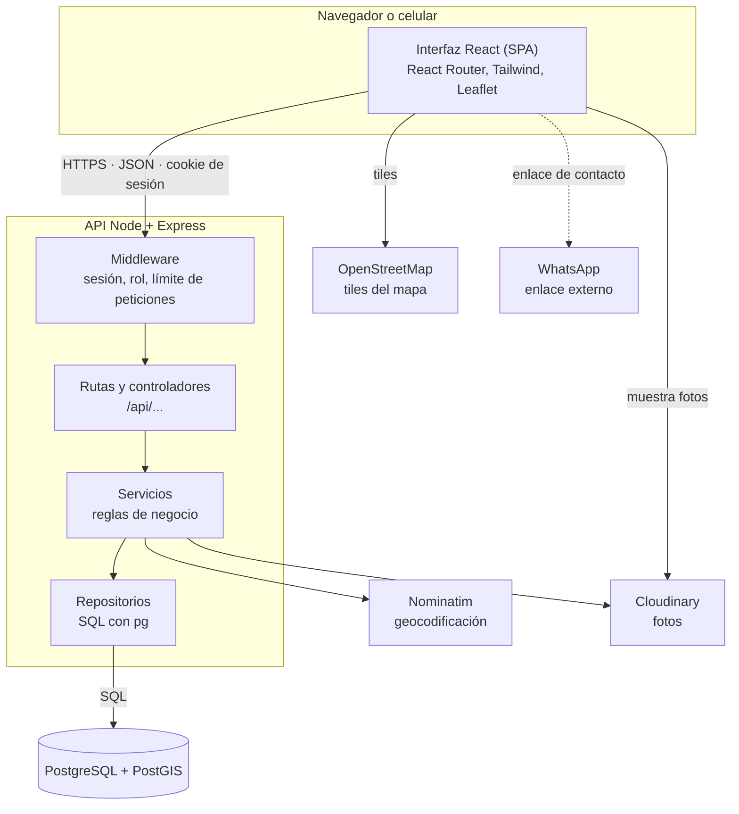
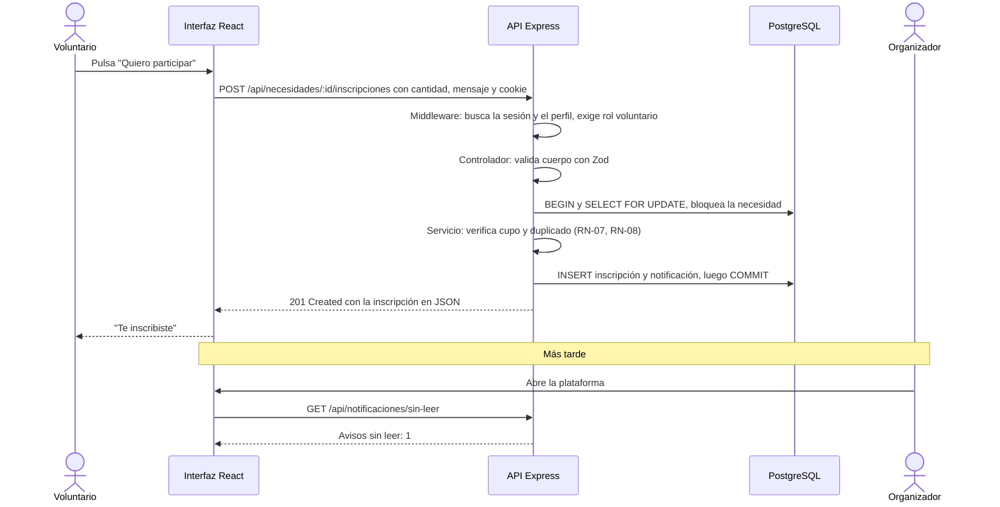
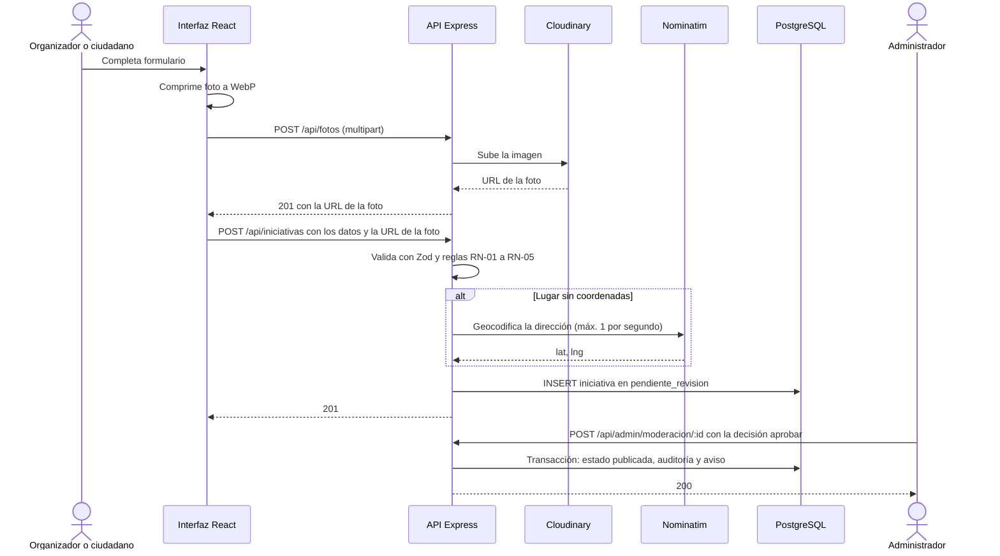

# 04 · Arquitectura del sistema

**Proyecto:** Calida
**Versión:** 0.3 · **Fecha:** 14/11/2026 · **Estado:** borrador
**Relacionados:** [01 · Diagrama de contexto](01-diagrama-de-contexto.md) · [02 · Casos de uso](02-casos-de-uso.md) · [03 · SRS](03-srs.md)

> **Cambio de la versión 0.3.** Calida es un proyecto para **aprender** a construir sistemas web: React, Node, bases de datos, la conexión entre frontend y backend, diseño, arquitectura y despliegue. La versión 0.2 usaba Next.js + Supabase, que resuelven el backend "por dentro" y lo esconden. Por eso la arquitectura cambia a **frontend React y backend Node/Express separados, con PostgreSQL propio**. Las decisiones viejas no se borran: quedan en la sección 13 marcadas como reemplazadas. Ver la lección L-03 en la [guía 00](00-guia-de-proyecto.md).

---

## 1. Objetivo y alcance

Este documento describe cómo está construido Calida: qué componentes tiene, cómo se comunican, dónde viven los datos, cómo se protegen y cómo se despliega. Sirve como guía para desarrollar el sistema y como referencia para tomar decisiones técnicas futuras.

Cubre la versión 1 (solo Cali, web responsive, sin pagos ni chat interno). Los requisitos que implementa están en el [SRS](03-srs.md).

**Nivel de exigencia.** La seguridad y la operación deben ser **suficientes y explicadas**, no de nivel producción. Cada control que se deja por fuera se escribe como decisión (ADR) o como riesgo, para que sea una elección consciente y no un olvido.

## 2. Principios de arquitectura

0. **Aprender es un objetivo del proyecto.** Si dos opciones compiten, se prefiere la que muestra cómo funciona algo por dentro, siempre que el alcance siga siendo razonable para una persona.
1. **Simplicidad primero.** Tres piezas propias: interfaz, API y base de datos. No hay microservicios ni colas de mensajes en v1.
2. **Defensa en dos lugares.** La API valida y decide permisos en cada petición. La base de datos impone las reglas que se pueden escribir como restricciones (`not null`, `check`, `unique`, llaves foráneas). Si la API tiene un error, la base todavía impide datos inválidos.
3. **Mobile-first.** La mayoría de los voluntarios usará el celular. Cada pantalla se diseña primero para 360 px.
4. **La ciudad es un dato, no una restricción.** Cada iniciativa tiene `ciudad`. El código no asume Cali, aunque la v1 solo acepte esa ciudad (RNF-016).
5. **Costo cero en v1.** OpenStreetMap, Cloudinary, Vercel, Render y Neon en planes gratuitos.
6. **Validar en el servidor.** Toda entrada se valida en la API, aunque también se valide en el formulario.

## 3. Vista general de contenedores



**Cómo se conectan el frontend y el backend:** la interfaz es una aplicación React que corre en el navegador. Cuando necesita datos, hace una petición HTTP con `fetch` a la API (por ejemplo `GET /api/iniciativas`). La API responde con JSON. La interfaz nunca habla directo con la base de datos: solo la API tiene la contraseña de la base.

### 3.1 Responsabilidades por componente

| Componente | Responsabilidad | No hace |
|---|---|---|
| **Interfaz React** | Muestra formularios, listado, mapa y paneles. Maneja la navegación (React Router), los filtros y el estado de la pantalla. Comprime fotos antes de subirlas. Valida formularios para avisar rápido. | No guarda secretos. No decide permisos (solo oculta botones; la API es la que decide). |
| **Middleware de la API** | Lee la cookie de sesión, busca la sesión en la base y carga el usuario. Exige un rol en las rutas que lo necesitan. Limita peticiones en login, registro y reportes. | No contiene reglas de negocio. |
| **Rutas y controladores** | Reciben la petición HTTP, validan el cuerpo con Zod, llaman al servicio y traducen el resultado a un código HTTP (200, 201, 400, 401, 403, 404, 409). | No escriben SQL. |
| **Servicios** | Aplican las reglas de negocio (RN-01 a RN-13) y los permisos de dueño ("¿esta iniciativa es tuya?"). Coordinan transacciones. Llaman a Nominatim y Cloudinary. | No saben de HTTP (no leen `req` ni `res`). |
| **Repositorios** | Ejecutan consultas SQL parametrizadas con `pg`. Una función por consulta. | No deciden permisos. |
| **PostgreSQL + PostGIS** | Guarda los datos. Impone restricciones (`check`, `unique`, llaves foráneas). Bloquea filas en transacciones. Busca por área del mapa. | No conoce la interfaz ni los usuarios de la aplicación. |
| **Cloudinary** | Guarda las fotos y las sirve por CDN, con miniaturas por URL. | No decide quién puede subir (lo decide la API). |

## 4. Stack tecnológico

| Capa | Tecnología | Decisión | Qué se aprende |
|---|---|---|---|
| Lenguaje | JavaScript (ES2022+), en front y back | Confirmado (ADR-04) | Un solo lenguaje en todo el sistema. |
| Frontend | React + Vite + React Router | Confirmado (ADR-16) | Componentes, estado, rutas del lado del cliente, `fetch`. |
| Estilos | Tailwind CSS | Confirmado (ADR-11) | Diseño mobile-first con clases utilitarias. |
| Mapa | Leaflet + react-leaflet + Leaflet.markercluster | Confirmado (ADR-05) | Integrar una librería de mapas. |
| Backend | Node.js + Express | Confirmado (ADR-16) | Servidor HTTP, rutas, middleware, API REST. |
| Base de datos | PostgreSQL + PostGIS | Confirmado (ADR-17) | SQL, restricciones, índices, transacciones. |
| Acceso a datos | `pg` (node-postgres), SQL escrito a mano | Confirmado (ADR-20) | Consultas parametrizadas, sin "magia" de un ORM. |
| Migraciones | Archivos `.sql` numerados y un script propio | Confirmado (ADR-20) | Qué es una migración y cómo se lleva el control. |
| Autenticación | `bcrypt` + tabla `sesiones` + cookie `httpOnly` (`cookie-parser`) | Confirmado (ADR-18) | Hash de contraseñas, sesiones, cookies. |
| Validación | Zod, con esquemas compartidos entre front y back | Confirmado (ADR-27) | Una sola fuente de verdad para los datos. |
| Límite de peticiones | `express-rate-limit` | Confirmado (ADR-24) | Proteger rutas sensibles. |
| Fotos | Cloudinary (plan gratuito) + `multer` | Confirmado (ADR-23) | Subida de archivos y servicios externos. |
| Geocodificación | Nominatim (OpenStreetMap) | Confirmado | Llamar a una API externa con límites de uso. |
| Base local | Docker Compose con la imagen `postgis/postgis` | Confirmado | Contenedores para el entorno de desarrollo. |
| Pruebas unitarias | Vitest | Propuesto | Probar funciones puras del dominio. |
| Pruebas de API | Vitest + Supertest | Propuesto | Probar endpoints sin navegador. |
| Pruebas end-to-end | Playwright | Propuesto | Flujos UC-03, UC-07 y UC-09 en navegador real. |
| Calidad de código | ESLint + Prettier | Propuesto | Consistencia y errores tempranos. |
| Hosting | Vercel (interfaz), Render (API), Neon (base) | Confirmado (ADR-25) | Desplegar un sistema de tres piezas. |
| Control de versiones | Git + GitHub + GitHub Actions | Propuesto | CI con pruebas y lint en cada cambio. |

**Versión de Node.js:** 24 (LTS), fijada en `.nvmrc` y en `engines` del `package.json`. Tiene soporte de seguridad hasta abril de 2028. Node 26 ya es LTS desde octubre de 2026, pero 24 es la que seguro soportan Vercel y Render; se cambia cuando haga falta.

## 5. Arquitectura lógica de la aplicación

El código se organiza en capas. Cada capa solo depende de la de abajo.

```
┌───────────────────────────────────────────────────────────────┐
│ Presentación    (frontend) páginas, componentes, mapa, fetch    │
╞═══════════════════════  HTTP + JSON  ═════════════════════════╡
│ Aplicación      (backend) rutas, middleware, controladores, Zod │
├───────────────────────────────────────────────────────────────┤
│ Dominio         (backend) servicios: reglas RN-01 a RN-13       │
├───────────────────────────────────────────────────────────────┤
│ Acceso a datos  (backend) repositorios SQL, Cloudinary, Nominatim│
└───────────────────────────────────────────────────────────────┘
```

**Regla clave:** las reglas de negocio se escriben como **funciones puras** (reciben datos y devuelven un resultado o un error) dentro de `servicios/` o `compartido/`. Así se prueban sin base de datos ni navegador. Los servicios llaman a esas funciones y luego a los repositorios.

### 5.1 Módulos

Cada módulo existe en el backend (rutas, servicio, repositorio) y en el frontend (páginas y componentes).

| Módulo | Casos de uso | Contenido principal |
|---|---|---|
| `cuentas` | UC-01, UC-02, UC-15 | Registro por tipo de cuenta, sesión, perfil. |
| `iniciativas` | UC-03, UC-04, UC-05 | Creación, edición, necesidades, cambios de estado. |
| `descubrimiento` | UC-06, UC-07, UC-08 | Listado, filtros, mapa, detalle. |
| `inscripciones` | UC-09, UC-10, UC-16 | Inscripción, gestión por el organizador, historial del voluntario. |
| `moderacion` | UC-11, UC-12, UC-13 | Reportes, cola, aprobación, suspensión. |
| `admin` | UC-13, UC-14 | Usuarios, catálogos (categorías y tipos de ayuda), estadísticas, auditoría. |
| `notificaciones` | Transversal | Creación de avisos y centro de notificaciones. |
| `compartido` | Transversal | Contratos, esquemas Zod, utilidades de fecha en `America/Bogota`. |

### 5.2 API REST

La API sigue convenciones REST: la URL nombra el recurso y el método HTTP dice la acción. Todas las rutas empiezan por `/api`.

| Método y ruta | Quién | Caso de uso | Respuestas típicas |
|---|---|---|---|
| `POST /api/cuentas/registro` | Visitante | UC-01 | 201, 400 datos inválidos, 409 correo ya existe |
| `POST /api/cuentas/sesion` | Visitante | UC-02 | 200 y cookie, 401, 423 bloqueado |
| `DELETE /api/cuentas/sesion` | Con sesión | UC-02 | 204 |
| `GET /api/cuentas/yo` | Con sesión | Transversal | 200 con el usuario, 401 |
| `GET /api/iniciativas?categoria=&pagina=` | Todos | UC-06 | 200 con lista paginada |
| `GET /api/iniciativas/mapa?oeste=&sur=&este=&norte=` | Todos | UC-07 | 200 |
| `GET /api/iniciativas/:id` | Todos | UC-08 | 200, 404 |
| `POST /api/iniciativas` | Organización o ciudadano | UC-03 | 201, 400, 403 |
| `PATCH /api/iniciativas/:id` | Dueño | UC-04, UC-05 | 200, 403, 409 estado no editable |
| `POST /api/fotos` | Organización o ciudadano | UC-03 | 201 con la URL de la foto |
| `POST /api/necesidades/:id/inscripciones` | Voluntario | UC-09 | 201, 409 sin cupo o ya inscrito |
| `PATCH /api/inscripciones/:id` | Organizador de la iniciativa | UC-10 | 200, 403 |
| `GET /api/inscripciones/mias` | Voluntario | UC-16 | 200 |
| `POST /api/iniciativas/:id/reportes` | Con sesión | UC-11 | 201, 409 ya reportada |
| `GET /api/admin/moderacion` · `POST /api/admin/moderacion/:id` | Administrador | UC-12 | 200 |
| `GET /api/notificaciones` · `GET /api/notificaciones/sin-leer` | Con sesión | Transversal | 200 |

La lista completa se escribe en la fase de construcción, módulo por módulo. Los cuerpos de petición y respuesta usan los tipos de [`compartido/contratos.js`](../compartido/contratos.js).

**Formato de error común:**

```json
{ "error": { "codigo": "SIN_CUPO", "mensaje": "La necesidad ya no tiene cupo." } }
```

### 5.3 Estructura de carpetas propuesta

Un solo repositorio (*monorepo*) con tres paquetes, unidos con **npm workspaces** (ADR-27):

```
calida/
├─ frontend/                   # React + Vite
│  ├─ src/
│  │  ├─ paginas/              # una carpeta por pantalla (listado, mapa, detalle, paneles)
│  │  ├─ componentes/          # piezas reutilizables (tarjeta, botón, formulario)
│  │  ├─ api/                  # funciones que llaman a la API con fetch
│  │  ├─ sesion/               # contexto de React con el usuario actual
│  │  └─ main.jsx              # rutas de React Router
│  ├─ public/                  # ilustraciones de imgs/svg
│  ├─ vite.config.js           # proxy /api → localhost:3000 en desarrollo
│  └─ vercel.json              # reescritura /api → Render en producción
├─ backend/                    # Node + Express
│  ├─ src/
│  │  ├─ rutas/                # un archivo por módulo: rutas y controladores
│  │  ├─ middleware/           # sesion.js, exigirRol.js, limites.js, errores.js
│  │  ├─ servicios/            # reglas de negocio y transacciones
│  │  ├─ repositorios/         # consultas SQL
│  │  ├─ externos/             # cloudinary.js, nominatim.js
│  │  ├─ db.js                 # pool de conexiones de pg
│  │  └─ app.js                # arma Express (se importa en pruebas)
│  ├─ scripts/migrar.js        # aplica las migraciones pendientes
│  └─ server.js                # arranca el servidor
├─ compartido/                 # lo usan front y back
│  ├─ contratos.js             # estados y tipos de datos (antes lib/contratos.js)
│  └─ esquemas.js              # esquemas Zod (RN-01 a RN-05)
├─ db/
│  ├─ migraciones/             # 001_tablas.sql, 002_indices.sql…
│  └─ semillas.sql             # categorías, tipos de ayuda y un administrador de prueba
├─ docker-compose.yml          # PostgreSQL + PostGIS local
├─ .nvmrc
└─ package.json                # workspaces: frontend, backend, compartido
```

## 6. Modelo de datos físico

### 6.1 Diferencias con `contratos.ts`

El modelo de `contratos.ts` necesitaba tres ajustes:

1. **Estados de iniciativa.** Faltaban dos estados para la moderación: `pendiente_revision` (enviada, esperando al administrador) y `rechazada`. Se pasó de 8 a 10 estados.
2. **Tipos de ayuda.** Pasaron de una lista fija a una tabla administrable (`tipos_ayuda`).
3. **Lenguaje.** Como el proyecto se escribe en JavaScript, los tipos se documentan con JSDoc o con esquemas Zod.

**Resuelto:** `src/types/contratos.ts` se reemplazó por `lib/contratos.js`, que en la fase 3 pasó a [`compartido/contratos.js`](../compartido/contratos.js), en JavaScript con JSDoc y alineado con las tablas de esta sección.

**Cambio de la versión 0.3:** sin Supabase no existe `auth.users`. Se agrega la tabla propia `usuarios`, que guarda el correo y el hash de la contraseña. `perfiles` sigue igual, pero su llave apunta a `usuarios`. Separar credenciales y perfil evita que el hash viaje por accidente en una respuesta de la API.

### 6.2 Tablas principales

```sql
-- Extensiones
create extension if not exists postgis;
create extension if not exists pgcrypto;   -- gen_random_uuid()

-- Enumeraciones
create type rol_usuario as enum ('organizacion', 'ciudadano', 'voluntario', 'administrador');
create type estado_cuenta as enum ('activo', 'suspendido');
create type estado_iniciativa as enum (
  'borrador', 'pendiente_revision', 'rechazada', 'publicada', 'en_preparacion',
  'lista', 'realizada', 'completada', 'suspendida', 'cancelada'
);
create type estado_necesidad as enum ('pendiente', 'comprometida', 'recibida', 'cubierta');
create type estado_inscripcion as enum ('pendiente', 'confirmada', 'rechazada', 'cancelada', 'cumplida');

-- Credenciales (ADR-18). La API nunca devuelve esta tabla.
create table usuarios (
  id                 uuid primary key default gen_random_uuid(),
  correo             text not null unique check (correo = lower(correo)),
  hash_contrasena    text not null,                         -- bcrypt; nunca la contraseña
  intentos_fallidos  int not null default 0,                -- RF-007
  bloqueado_hasta    timestamptz,                           -- RF-007
  creado_en          timestamptz not null default now()
);

-- Sesiones abiertas (ADR-18). La cookie del navegador solo lleva el id.
create table sesiones (
  id          text primary key,                               -- 32 bytes aleatorios en hexadecimal
  usuario_id  uuid not null references usuarios(id) on delete cascade,
  creada_en   timestamptz not null default now(),
  vence_en    timestamptz not null                            -- creada_en + 7 días
);

-- Perfil: datos públicos y de negocio, uno por usuario
create table perfiles (
  id           uuid primary key references usuarios(id) on delete cascade,
  rol          rol_usuario not null,
  nombre       text not null check (char_length(nombre) between 2 and 80),
  telefono     text check (telefono ~ '^3[0-9]{9}$'),        -- celular colombiano, 10 dígitos
  estado       estado_cuenta not null default 'activo',
  verificada   boolean not null default false,               -- solo organizaciones
  descripcion  text check (char_length(descripcion) <= 1000),
  ciudad       text not null default 'Cali',
  creado_en    timestamptz not null default now()
);

-- Catálogos administrables
create table categorias (
  id      serial primary key,
  nombre  text not null unique,
  activa  boolean not null default true
);
create table tipos_ayuda (
  id      serial primary key,
  nombre  text not null unique,   -- mano de obra, donaciones, transporte, asesoría, difusión, otro
  activo  boolean not null default true
);

-- Iniciativa
create table iniciativas (
  id               uuid primary key default gen_random_uuid(),
  organizador_id   uuid not null references perfiles(id) on delete restrict,
  titulo           text not null check (char_length(titulo) between 5 and 120),
  descripcion      text not null check (char_length(descripcion) between 20 and 2000),
  categoria_id     int not null references categorias(id),
  foto_url         text not null,                              -- URL de Cloudinary
  ciudad           text not null default 'Cali',
  lugar            text not null,                              -- dirección escrita
  ubicacion        geography(point, 4326),                     -- PostGIS; null si no se pudo geocodificar
  fecha_inicio     timestamptz not null,
  fecha_fin        timestamptz,
  medio_contacto   text not null check (
                     medio_contacto ~ '^https://(chat\.whatsapp\.com|wa\.me)/' or
                     medio_contacto ~ '^3[0-9]{9}$'
                   ),
  estado           estado_iniciativa not null default 'borrador',
  motivo_rechazo   text,
  publicada_en     timestamptz,
  actualizada_en   timestamptz not null default now(),
  check (fecha_fin is null or fecha_fin >= fecha_inicio)
);

-- Relación muchos a muchos entre iniciativas y tipos de ayuda
create table iniciativa_tipos_ayuda (
  iniciativa_id  uuid references iniciativas(id) on delete cascade,
  tipo_ayuda_id  int references tipos_ayuda(id),
  primary key (iniciativa_id, tipo_ayuda_id)
);

-- Necesidades: lo que hace falta dentro de una iniciativa
create table necesidades (
  id                  uuid primary key default gen_random_uuid(),
  iniciativa_id       uuid not null references iniciativas(id) on delete cascade,
  tipo_ayuda_id       int not null references tipos_ayuda(id),
  nombre              text not null,
  unidad              text not null,                          -- personas, unidades, kg, viajes…
  cantidad_objetivo   int not null check (cantidad_objetivo > 0),
  cantidad_confirmada int not null default 0,
  estado              estado_necesidad not null default 'pendiente',
  check (cantidad_confirmada >= 0 and cantidad_confirmada <= cantidad_objetivo)  -- RN-07
);

-- Inscripciones de voluntarios
create table inscripciones (
  id              uuid primary key default gen_random_uuid(),
  necesidad_id    uuid not null references necesidades(id) on delete cascade,
  voluntario_id   uuid not null references perfiles(id) on delete cascade,
  cantidad        int not null check (cantidad > 0),
  mensaje         text check (char_length(mensaje) <= 500),
  estado          estado_inscripcion not null default 'pendiente',
  creada_en       timestamptz not null default now(),
  actualizada_en  timestamptz not null default now(),
  unique (necesidad_id, voluntario_id)                        -- RN-08
);

-- Reportes de iniciativas (RN-11)
create table reportes (
  id              uuid primary key default gen_random_uuid(),
  iniciativa_id   uuid not null references iniciativas(id) on delete cascade,
  reportado_por   uuid not null references perfiles(id) on delete cascade,
  motivo          text not null check (motivo in ('fraude', 'contenido_inapropiado', 'datos_falsos', 'otro')),
  descripcion     text check (char_length(descripcion) <= 1000),
  estado          text not null default 'abierto',
  creado_en       timestamptz not null default now(),
  unique (iniciativa_id, reportado_por)
);

-- Avisos dentro de la plataforma
create table notificaciones (
  id            uuid primary key default gen_random_uuid(),
  destinatario  uuid not null references perfiles(id) on delete cascade,
  tipo          text not null,                                 -- inscripcion_nueva, inscripcion_estado, moderacion…
  mensaje       text not null,
  referencia_id uuid,                                          -- iniciativa o inscripción relacionada
  leida         boolean not null default false,
  creada_en     timestamptz not null default now()
);

-- Auditoría de acciones administrativas (RNF-020)
create table auditoria (
  id              bigserial primary key,
  administrador_id uuid not null references perfiles(id),
  accion          text not null,
  entidad         text not null,
  entidad_id      uuid,
  detalle         jsonb,
  creada_en       timestamptz not null default now()
);

-- Control de migraciones aplicadas (lo usa backend/scripts/migrar.js)
create table migraciones (
  nombre      text primary key,                                -- 001_tablas.sql
  aplicada_en timestamptz not null default now()
);
```

### 6.3 Índices

| Índice | Tabla | Para qué |
|---|---|---|
| `GIST(ubicacion)` | iniciativas | Consultas de mapa por área visible (ADR-13). |
| `(estado, fecha_inicio)` | iniciativas | Listado de publicadas ordenado por fecha. |
| `(categoria_id)`, `(ciudad)` | iniciativas | Filtros frecuentes. |
| `(iniciativa_id)` | necesidades | Carga del detalle. |
| `(voluntario_id, creada_en)` | inscripciones | Historial del voluntario (UC-16). |
| `(destinatario, leida)` | notificaciones | Contador de avisos sin leer. |

`usuarios.correo` y `sesiones.id` ya tienen índice por ser `unique` y llave primaria. El primero lo usa el login; el segundo, cada petición con sesión.

### 6.4 Consultas críticas

**Iniciativas visibles en el mapa** (UC-07): solo se piden las del área visible. Los `$1…$4` son **parámetros**: `pg` los envía aparte del texto SQL, y por eso no hay inyección SQL.

```sql
select id, titulo, foto_url, fecha_inicio, categoria_id,
       st_y(ubicacion::geometry) as lat, st_x(ubicacion::geometry) as lng
from iniciativas
where estado in ('publicada', 'en_preparacion')
  and ubicacion && st_makeenvelope($1, $2, $3, $4, 4326)   -- oeste, sur, este, norte
  and (fecha_fin is null or fecha_fin >= now())
order by fecha_inicio
limit 300;
```

Si el área contiene más de 300 iniciativas, el mapa agrupa en el cliente con Leaflet.markercluster.

**Iniciativas vencidas.** Sin tareas programadas (ADR-26), una iniciativa cuya fecha ya pasó no cambia sola a *realizada*. Las consultas públicas la ocultan con la condición `fecha_fin >= now()` (o `fecha_inicio` si no hay fin), y el organizador la marca como realizada desde su panel.

## 7. Seguridad

### 7.1 Autenticación y sesiones (ADR-18)

1. **Registro:** la API valida los datos, calcula el hash de la contraseña con `bcrypt` (costo 10) y guarda `usuarios` y `perfiles` **en una sola transacción**. La contraseña nunca se guarda ni se escribe en logs.
2. **Inicio de sesión:** la API busca el correo y compara la contraseña con `bcrypt.compare`. Si es correcta, genera un id aleatorio con `crypto.randomBytes(32)`, guarda una fila en `sesiones` que vence en 7 días y envía el id en una cookie:
   ```
   Set-Cookie: sesion=<id aleatorio>; HttpOnly; Secure; SameSite=Lax; Path=/; Max-Age=604800
   ```
   La cookie no contiene datos del usuario: es solo una "llave" que apunta a una fila de la base. En el mismo paso se borran las sesiones vencidas de ese usuario (no hay tareas programadas, ADR-26).
   - `HttpOnly`: JavaScript del navegador no puede leerla, así que un ataque XSS no puede robarla.
   - `SameSite=Lax`: el navegador no la envía en peticiones que otro sitio dispara (protección contra CSRF).
   - `Secure`: solo viaja por HTTPS (en local se desactiva).
3. **Cada petición:** el middleware `sesion.js` lee la cookie y, con una sola consulta, busca la sesión y el perfil:
   ```sql
   select p.* from sesiones s join perfiles p on p.id = s.usuario_id
   where s.id = $1 and s.vence_en > now();
   ```
   Si no hay fila, la petición sigue como visitante (o responde 401 si la ruta exige sesión). Si el perfil está **suspendido**, responde 401 (RN-09). Así una suspensión tiene efecto inmediato.
4. **Cerrar sesión:** la API borra la fila de `sesiones` y la cookie. Desde ese momento, el id deja de servir aunque alguien lo haya copiado.
5. **Suspender a un usuario:** además de cambiar su estado, se borran todas sus sesiones.
6. **Bloqueo por intentos (RF-007):** cada fallo suma `intentos_fallidos`. Al llegar a 5, se fija `bloqueado_hasta = now() + 15 minutos` y el login responde 423. Un login correcto reinicia el contador.
7. **Mensaje genérico:** el login responde igual si el correo no existe o si la contraseña es incorrecta (UC-02 A1).
8. **Sin correo en v1 (ADR-22):** no hay verificación de correo ni recuperación de contraseña. Ver los riesgos en la sección 12.

### 7.2 Autorización en la API (ADR-19)

La autorización se decide en dos niveles:

1. **Por rol, en el middleware.** Cada ruta declara quién puede usarla:
   ```js
   router.post('/necesidades/:id/inscripciones', exigirRol('voluntario'), inscribirse);
   ```
2. **Por dueño, en el servicio.** Antes de modificar algo, el servicio comprueba que pertenece al usuario. Para eso, el `where` de la consulta incluye siempre el id de la sesión:
   ```sql
   update iniciativas set titulo = $1
   where id = $2 and organizador_id = $3;   -- $3 sale de la sesión, nunca del cuerpo
   ```
   Si no se actualizó ninguna fila, la API responde 404. No responde 403, para no revelar que la iniciativa existe.

| Recurso | Lectura | Escritura |
|---|---|---|
| `iniciativas` | Pública si el estado es publicada o en preparación. El organizador ve las suyas. El administrador ve todas. | Solo el organizador, y solo en estados editables. El cambio a *publicada* solo lo hace el administrador. |
| `necesidades` | Pública si la iniciativa es pública. | Solo el organizador de la iniciativa. |
| `inscripciones` | El voluntario ve las suyas. El organizador ve las de sus iniciativas, con datos de contacto. Nadie más. | Crear: solo voluntarios activos, para sí mismos. Cambiar estado: solo el organizador. |
| `perfiles` | Cada usuario ve su perfil. Datos públicos mínimos de organizaciones visibles en iniciativas. | Cada usuario edita su perfil, sin cambiar `rol` ni `verificada`. |
| `usuarios` | Nadie, nunca sale de la API. | Solo registro y login. |
| `reportes` | Solo el administrador y el autor del reporte. | Crear: usuarios con sesión. |
| `notificaciones` | Solo el destinatario. | Solo los servicios de la API. |
| `auditoria` | Solo el administrador. | Solo los servicios. Ninguna ruta permite editar ni borrar. |
| `categorias`, `tipos_ayuda` | Públicas. | Solo el administrador. |

**Qué se pierde sin RLS.** En la versión 0.2, PostgreSQL revisaba los permisos fila por fila (*Row Level Security*), aunque el código tuviera un error. Ahora, si un servicio olvida el `organizador_id = $3`, la base no lo detiene. Se acepta porque la API es el único cliente de la base, y para aprender es más claro ver el permiso escrito en el código. La mitigación es **una prueba de API por regla de la tabla anterior** (por ejemplo: "un organizador no puede editar la iniciativa de otro → 404").

### 7.3 Operaciones que necesitan transacción (ADR-21)

Algunas reglas leen y escriben varias filas que otros usuarios pueden cambiar al mismo tiempo. Se hacen dentro de una **transacción** en el servicio, con un cliente del pool de `pg`:

- **Inscribirse (RN-07, RN-08, RF-036):**
  ```sql
  BEGIN;
  SELECT cantidad_objetivo, cantidad_confirmada FROM necesidades
   WHERE id = $1 FOR UPDATE;               -- bloquea la fila: el segundo voluntario espera aquí
  -- el servicio verifica cupo y duplicado
  INSERT INTO inscripciones (...) VALUES (...);
  INSERT INTO notificaciones (...) VALUES (...);   -- aviso al organizador
  COMMIT;                                   -- o ROLLBACK si algo falló
  ```
  Sin `FOR UPDATE`, dos voluntarios leen "queda 1 cupo" al mismo tiempo y ambos se inscriben. El `unique` y el `check` de la tabla son la última barrera si el código falla.
- **Confirmar inscripción:** actualiza la inscripción, suma a `cantidad_confirmada` y recalcula el estado de la necesidad.
- **Moderar:** cambia el estado de la iniciativa, inserta en `auditoria` y crea el aviso para el autor.
- **Reportes automáticos (RN-11):** al crear un reporte, en la misma transacción se cuentan los reportes distintos. Si llegan a 3, la iniciativa pasa a `pendiente_revision`.

### 7.4 Protección de la aplicación

| Amenaza | Control |
|---|---|
| Inyección SQL | Consultas parametrizadas con `pg` (`$1, $2…`). Nunca se concatena texto del usuario en el SQL. |
| XSS | React escapa el contenido por defecto. Se prohíbe `dangerouslySetInnerHTML`. Cabeceras de seguridad con `helmet`. |
| CSRF | Cookie `SameSite=Lax` y API en el mismo origen que la interfaz (sección 11.3). La API solo acepta cuerpos JSON. |
| Robo de sesión | Cookie `HttpOnly` y `Secure`. El id de sesión es aleatorio (32 bytes), imposible de adivinar, y se puede invalidar borrando su fila. |
| Contraseñas filtradas | Hash con `bcrypt`. La tabla `usuarios` nunca se devuelve en la API. |
| Fuerza bruta en login | Bloqueo por intentos (sección 7.1) y límite de peticiones (sección 7.5). |
| Subida de archivos maliciosos | `multer` limita el tamaño a 2 MB y acepta solo `image/webp`, `image/jpeg` y `image/png`. Cloudinary vuelve a procesar la imagen. |
| Errores que revelan detalles | El middleware de errores responde un mensaje genérico. El detalle solo va al log del servidor. |

### 7.5 Limitación de peticiones (ADR-24)

Con `express-rate-limit`, en memoria del proceso:

| Ruta | Límite |
|---|---|
| `POST /api/cuentas/sesion` | 10 por IP cada 15 minutos. |
| `POST /api/cuentas/registro` | 5 por IP cada hora. |
| `POST /api/iniciativas/:id/reportes` | 10 por usuario cada hora. |

El contador vive en la memoria del servidor: se reinicia si Render reinicia el proceso, y no se comparte si hubiera varias copias de la API. Para v1, con una sola copia, es suficiente.

Además, el riesgo de spam ya es bajo: publicar, inscribirse y reportar exigen cuenta; cada usuario reporta una vez por iniciativa (`unique`), y las publicaciones pasan por moderación (UC-12).

### 7.6 Datos personales (Ley 1581 de 2012)

- El registro muestra el aviso de privacidad y pide autorización explícita (checkbox sin marcar por defecto).
- Los teléfonos y correos de voluntarios solo los ve el organizador de la iniciativa. Lo garantiza el servicio de inscripciones (consulta filtrada por `organizador_id`) y lo comprueba una prueba de API.
- Supresión de datos: el usuario puede eliminar su cuenta desde su perfil. El servicio borra o anonimiza sus datos y conserva los registros de auditoría sin datos personales.
- Las fotos no deben contener datos personales identificables de menores sin autorización. Esto se incluye en los términos de uso.

## 8. Flujos principales

### 8.1 Inscripción de un voluntario (UC-09)



### 8.2 Publicación con moderación (UC-03, UC-12)



### 8.3 Carga del mapa (UC-07)

1. El navegador obtiene los límites visibles del mapa.
2. Pide `GET /api/iniciativas/mapa?oeste=…&sur=…&este=…&norte=…`, que ejecuta la consulta de la sección 6.4.
3. Si el área tiene muchos resultados, Leaflet.markercluster agrupa los marcadores.
4. Los tiles de OpenStreetMap se cargan desde su servidor. Se muestra la atribución obligatoria "© OpenStreetMap contributors".
5. Al mover el mapa, la petición anterior se cancela con `AbortController`, para no mostrar resultados viejos.

### 8.4 Avisos dentro de la plataforma (ADR-06, ADR-26)

- Cada evento relevante inserta una fila en `notificaciones`, dentro de la misma transacción que el evento.
- La interfaz pide `GET /api/notificaciones/sin-leer` al cargar y luego cada 60 segundos mientras la pestaña está visible.
- Un contador en la barra superior muestra los avisos sin leer.
- Avisos en tiempo real con WebSocket quedan como mejora futura.

## 9. Servicios externos

### 9.1 OpenStreetMap: tiles y Nominatim

- **Tiles:** uso gratuito con atribución obligatoria. Para tráfico alto, la política de uso exige un servicio de tiles propio o comercial. Para la v1, con pocos usuarios, el uso gratuito es suficiente.
- **Nominatim (geocodificación):** su política limita a **1 petición por segundo**, exige un `User-Agent` identificable y prohíbe usarlo para cargas masivas.
  - La API llama a Nominatim, nunca el navegador. Así el `User-Agent` y el límite se controlan en un solo lugar.
  - La geocodificación solo ocurre al publicar, nunca al cargar el mapa.
  - Las coordenadas se guardan en la iniciativa, así que cada dirección se geocodifica una sola vez.
  - Si el usuario mueve el marcador en el mapa, no se llama a Nominatim.
- **Límites de Cali:** la validación de RN-03 usa un rectángulo aproximado de referencia (sur 3.30, norte 3.55, oeste −76.65, este −76.42).

### 9.2 Cloudinary (ADR-23)

- La interfaz redimensiona la imagen a 1200 px de ancho máximo y la comprime a WebP con calidad 80 antes de subirla (ADR-10, RNF-019).
- La interfaz envía el archivo a `POST /api/fotos` como `multipart/form-data`. La API lo recibe con `multer` (en memoria), lo sube a Cloudinary en la carpeta `calida/iniciativas` y devuelve la URL.
- Las miniaturas del listado se piden a Cloudinary cambiando la URL (por ejemplo `w_400`), sin guardar un segundo archivo.
- Las credenciales de Cloudinary solo existen en la API.

### 9.3 Correo (ADR-06, ADR-22)

En v1 no hay ningún correo: ni avisos, ni verificación de cuenta, ni recuperación de contraseña.

**Consecuencias:** un usuario que no entra a la plataforma no se entera de inscripciones o cambios, y un usuario que olvida su contraseña no puede recuperarla solo. Ver la sección 12.

## 10. Rendimiento y caché

La interfaz es una SPA: el navegador descarga la aplicación una vez y después solo pide datos JSON.

| Página o dato | Estrategia | Justificación |
|---|---|---|
| Archivos de la interfaz (JS, CSS, imágenes) | Vercel los sirve desde su CDN con caché larga; Vite pone un hash en el nombre de cada archivo. | Cargas repetidas casi instantáneas. |
| Listado público (UC-06) | Paginado de a 20. Respuesta con `Cache-Control: public, max-age=60`. | Cumple RNF-001 sin traer las 500 iniciativas de una vez. |
| Detalle de iniciativa | `Cache-Control: public, max-age=60`. | El contenido cambia poco. |
| Mapa | Consulta por área visible, sin caché. Caché de tiles en el navegador. | Los datos dependen del área. |
| Paneles y avisos | `Cache-Control: no-store`. | Datos privados. |
| Estadísticas del administrador | Consultas agregadas normales. | Con el volumen de v1 son rápidas. Si se vuelven lentas, se usa una vista materializada. |
| Imágenes | WebP, miniaturas de Cloudinary, `loading="lazy"` en listados. | Cumple RNF-019. |

**Presupuesto de rendimiento:** JavaScript inicial menor a 150 KB comprimido. La página del mapa se carga de forma diferida (`React.lazy`), solo en `/mapa`.

**Límite conocido de una SPA:** los buscadores ven menos contenido que con páginas renderizadas en servidor. No hay un requisito de SEO en v1, así que se acepta.

## 11. Despliegue y entornos

### 11.1 Entornos

| Entorno | Propósito | Interfaz | API | Base de datos |
|---|---|---|---|---|
| **Local** | Desarrollo diario. | `vite` en `localhost:5173` | `node --watch` en `localhost:3000` | Docker Compose (`postgis/postgis`) |
| **Producción** | Uso real y demos. | Vercel | Render (servicio web gratuito) | Neon (plan gratuito, con PostGIS) |

No hay entorno de pruebas separado en v1: las pruebas automáticas corren en GitHub Actions con su propia base temporal.

### 11.2 Flujo de trabajo

1. Cada cambio se hace en una rama y se abre un Pull Request.
2. GitHub Actions levanta un PostgreSQL temporal, aplica las migraciones y ejecuta lint y pruebas.
3. Las migraciones son archivos `db/migraciones/NNN_descripcion.sql`. Nunca se edita una migración ya aplicada: se crea una nueva.
4. Al unir el PR a `main`: Vercel despliega la interfaz, Render despliega la API, y un paso de GitHub Actions ejecuta `npm run migrar` contra Neon.

### 11.3 Cómo se encuentran la interfaz y la API

La interfaz y la API viven en servidores distintos. Para que el navegador las vea como **un solo sitio** (mismo origen), las peticiones a `/api` se reenvían:

- **En local:** el *proxy* de Vite manda `/api/*` a `localhost:3000`.
- **En producción:** una **reescritura** de Vercel (`vercel.json`) manda `/api/*` a la URL de Render.

Así la cookie de sesión funciona con `SameSite=Lax` y no hace falta configurar CORS. CORS es el mecanismo con el que un servidor permite peticiones desde **otro** origen. Se estudia como concepto, pero el proxy evita necesitarlo.

### 11.4 Variables de entorno

| Variable | Dónde | Para qué |
|---|---|---|
| `DATABASE_URL` | API, GitHub Actions | Conexión a PostgreSQL (local o Neon). |
| `CLOUDINARY_URL` | API | Credenciales de Cloudinary. |
| `NOMINATIM_USER_AGENT` | API | Identificación exigida por Nominatim. |
| `NODE_ENV` | API | `development` o `production` (activa `Secure` en la cookie). |
| `PORT` | API | Puerto del servidor. Render lo asigna. |

La interfaz no necesita variables secretas: todo lo sensible está en la API. Cada paquete tiene un `.env.example` sin valores reales, y `.env*` está en `.gitignore`.

### 11.5 Respaldos y recuperación

- Neon guarda un historial corto que permite restaurar la base a un momento reciente.
- Además, un volcado semanal con `pg_dump` (manual o con GitHub Actions) se guarda fuera de Neon (RNF-018).
- Se practica una restauración en local una vez antes de dar el sistema por terminado.

## 12. Riesgos técnicos

| Riesgo | Impacto | Mitigación |
|---|---|---|
| Sin correo de avisos, los usuarios no se enteran de inscripciones. | Alto. Los organizadores pueden tardar en responder. | Contador de avisos en la plataforma. Correo en v1.1 (por ejemplo, con Resend). |
| Sin recuperación de contraseña (ADR-22). | Medio. Un usuario que la olvida pierde el acceso. | En v1, el administrador puede ayudar manualmente. En v1.1, recuperación por correo. |
| Sin verificación de correo (ADR-22). | Bajo. Se pueden crear cuentas con correos ajenos. | Las publicaciones pasan por moderación. Límite de registros por IP. |
| Un servicio olvida revisar el dueño de un recurso (sin RLS). | Alto. Un usuario podría modificar datos ajenos. | Una prueba de API por cada regla de autorización (sección 7.2). Revisión de cada PR. |
| Render gratuito se duerme tras unos minutos sin uso. | Medio. La primera petición tarda cerca de un minuto. | Aceptado para un proyecto de aprendizaje. Mostrar "cargando" en la interfaz. RNF-003 no se garantiza con este plan. |
| Cuotas del plan gratuito de Neon y Cloudinary. | Bajo con pocos usuarios. | Revisar el uso en sus paneles una vez al mes. |
| Límites de uso de Nominatim. | Medio. Publicaciones lentas o bloqueadas. | Geocodificar una sola vez, desde la API, máximo 1 por segundo. |
| Condiciones de carrera en cupos. | Medio. Sobre-inscripción. | Transacción con `FOR UPDATE` y prueba de concurrencia. |
| Copia de la base filtrada con sesiones abiertas. | Medio. Se podrían usar sesiones ajenas hasta que venzan. | `delete from sesiones` las cierra todas. Mejora futura: guardar el hash del id, no el id. |
| Fotos inapropiadas. | Medio. | Reporte (UC-11), moderación previa (UC-12) y términos de uso. |
| Dependencia de WhatsApp para contacto. | Bajo. | Es el canal que el usuario ya conoce. El sistema solo muestra el enlace. |

## 13. Decisiones de arquitectura (resumen)

Las decisiones reemplazadas se conservan tachadas: muestran qué se pensó y por qué cambió.

| ID | Decisión | Alternativas consideradas | Motivo |
|---|---|---|---|
| ~~ADR-01~~ | ~~Un solo proyecto Next.js como frontend y API.~~ **Reemplazada por ADR-16.** | Frontend separado con API independiente. | Menos piezas que operar. |
| ~~ADR-02~~ | ~~Supabase como backend.~~ **Reemplazada por ADR-17 y ADR-18.** | Backend propio con Node y Postgres. | Auth, Storage y Realtime resueltos. |
| ~~ADR-03~~ | ~~Reglas de acceso en RLS, además de validación en el código.~~ **Reemplazada por ADR-19.** | Solo validación en la API. | La base de datos protege aunque falle la API. |
| ADR-04 | JavaScript, sin TypeScript. | TypeScript. | Preferencia del equipo. Se documenta con JSDoc y Zod. |
| ADR-05 | OpenStreetMap con Leaflet. | Google Maps. | Costo cero. Suficiente para el alcance. |
| ADR-06 | Avisos solo dentro de la plataforma. | Correo transaccional. | Decisión del equipo para v1. Riesgo documentado en la sección 12. |
| ADR-07 | Estados de iniciativa ampliados a 10. | Mantener los 8 de `contratos.ts`. | La moderación necesita `pendiente_revision` y `rechazada`. |
| ~~ADR-08~~ | ~~Lógica crítica en funciones de PostgreSQL.~~ **Reemplazada por ADR-21.** | Lógica solo en Node. | Evita condiciones de carrera en cupos. |
| ADR-09 | Monolito modular. | Microservicios. | El tamaño del equipo y del alcance no lo justifican. |
| ADR-10 | Compresión de fotos en el cliente. | Procesamiento en servidor. | Reduce costo y tiempo de subida. |
| ADR-11 | Tailwind CSS para estilos. | CSS propio, CSS Modules, librería de componentes. | Clases utilitarias que favorecen el diseño mobile-first. |
| ~~ADR-12~~ | ~~Supabase en plan gratuito.~~ **Reemplazada por ADR-17 y ADR-25.** | Plan Pro. | Costo cero. |
| ADR-13 | PostGIS solo para buscar por área del mapa. Sin cálculo de distancias. | Ordenar por distancia al usuario (RF-029). | No hace falta en v1. RF-029 pasa a *Won't*. |
| ~~ADR-14~~ | ~~Subdominio de Vercel; proyectos de Supabase y Vercel llamados `calida`.~~ **Reemplazada por ADR-25** (sigue sin dominio propio). | Comprar un dominio. | Costo cero. |
| ~~ADR-15~~ | ~~Sin limitación de peticiones propia; reglas de Vercel si hace falta.~~ **Reemplazada por ADR-24.** | Contador en base de datos; Upstash Redis. | Simplicidad. |
| ADR-16 | Interfaz React (Vite, SPA) y API Node/Express **separadas**, en el mismo repositorio. | Next.js como frontend y API (ADR-01). | **Objetivo de aprendizaje (principio 0):** la frontera entre front y back queda visible como peticiones HTTP con JSON. Más piezas que desplegar, pero cada una se entiende por separado. |
| ADR-17 | PostgreSQL + PostGIS propio: Docker en local, Neon en producción. | Supabase (ADR-02). | Aprender a crear el esquema, conectarse y operar la base. Neon es gratis y soporta PostGIS. |
| ADR-18 | Autenticación propia: `bcrypt`, tabla `usuarios` y **sesiones guardadas en la base** (tabla `sesiones`); la cookie `HttpOnly` lleva solo un id aleatorio. *Revisada el 14/11/2026: antes decía JWT.* | Supabase Auth; JWT en cookie; token en `localStorage` con cabecera `Authorization`. | Entender hash, cookies y sesiones por dentro. El JWT evita consultar la base, pero aquí el perfil se carga en cada petición de todas formas (RN-09), así que no ahorraba nada. La tabla es más simple (sin librería ni secreto), permite cerrar sesión de verdad y practica SQL. `localStorage` se descarta porque un ataque XSS podría leer el token. |
| ADR-19 | Autorización en la API: middleware por rol y dueño en el `where` de cada consulta. Restricciones en la base, sin RLS. | RLS de PostgreSQL (ADR-03). | Un solo lugar donde leer los permisos, más fácil de aprender. El riesgo se cubre con pruebas de API (sección 12). |
| ADR-20 | SQL escrito a mano con `pg`, sin ORM. Migraciones como archivos SQL numerados y un script propio. | Prisma, Sequelize, Knex, node-pg-migrate. | Aprender SQL de verdad y ver qué hace una herramienta de migraciones. Un ORM se puede probar después, ya entendiendo lo que esconde. |
| ADR-21 | Operaciones críticas como transacciones en los servicios de Node (`BEGIN`, `FOR UPDATE`, `COMMIT`). | Funciones de PostgreSQL (ADR-08). | La lógica queda en JavaScript, junto al resto del código, y la transacción se ve paso a paso. Las restricciones de la tabla siguen siendo la última barrera. |
| ADR-22 | Sin correo en v1: no hay verificación de cuenta ni recuperación de contraseña (RF-004 y RF-006 pasan a *Won't*). | Resend, Brevo o SMTP propio. | Simplicidad. **Cuándo hacerlo:** cuando haya usuarios reales. **Cómo:** un servicio de correo con plan gratuito y un token temporal en una tabla. |
| ADR-23 | Fotos en Cloudinary, subidas a través de la API con `multer`. | Disco del servidor; Supabase Storage; Amazon S3. | El disco de Render se borra en cada despliegue. Cloudinary es gratis y genera miniaturas por URL. Pasar por la API enseña a recibir archivos. |
| ADR-24 | Limitación de peticiones con `express-rate-limit` en memoria, en login, registro y reportes. | Sin límite (ADR-15); Redis. | Unas pocas líneas de código y se aprende el concepto. Suficiente con una sola copia de la API. |
| ADR-25 | Despliegue gratuito en tres servicios: Vercel (interfaz), Render (API), Neon (base). Vercel reescribe `/api` hacia Render. Sin dominio propio. | Todo en un VPS; Railway; Fly.io. | Costo cero y práctica con varios servicios. La reescritura hace que todo parezca un solo sitio, sin CORS y con cookies `SameSite=Lax`. |
| ADR-26 | Sin tareas programadas ni tiempo real: avisos por consulta cada 60 s; iniciativas vencidas filtradas por fecha. | pg_cron, node-cron, WebSocket. | Menos piezas. Render gratuito se duerme, así que un proceso programado no sería confiable. |
| ADR-27 | Monorepo con npm workspaces: `frontend/`, `backend/`, `compartido/`. Contratos y esquemas Zod en `compartido/`. | Dos repositorios; copiar los esquemas en cada lado. | Una sola fuente de verdad para los datos (lección L-01). Un solo PR cambia front y back juntos. |

## 14. Pendientes técnicos

1. ~~Confirmar si Tailwind CSS es la librería de estilos.~~ Resuelto: ADR-11.
2. ~~Confirmar el plan de Supabase para producción.~~ Ya no aplica: ADR-17.
3. ~~Decidir cómo limitar peticiones.~~ Resuelto: ADR-24.
4. ~~Confirmar si se usará PostGIS para distancias o solo para el mapa.~~ Resuelto: ADR-13.
5. ~~Definir el dominio y el nombre del proyecto.~~ Resuelto: ADR-25. Los servicios se llaman `calida` (interfaz) y `calida-api` (API).
6. ~~Mover `lib/contratos.js` a `compartido/contratos.js` al crear el monorepo (fase 3).~~ Hecho.
