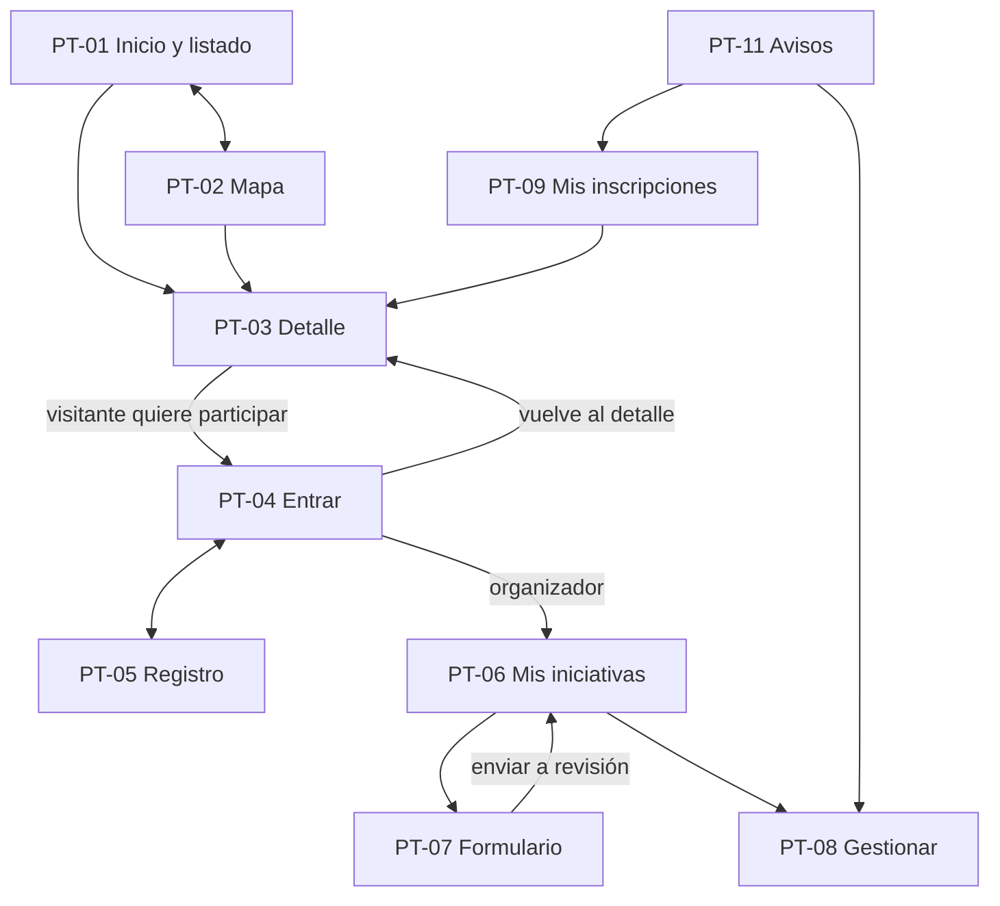

# 05 · Diseño de pantallas

**Proyecto:** Calida
**Versión:** 0.3 · **Fecha:** 18/11/2026 · **Estado:** borrador (etapas 1 y 2 hechas, dirección estética en §5.7; falta probar con usuarios)
**Relacionados:** [02 · Casos de uso](02-casos-de-uso.md) · [03 · SRS §7.1](03-srs.md) · [04 · Arquitectura](04-arquitectura.md)

> **Dos etapas.** Este documento es la **etapa 1**: qué pantallas hay, cómo se pasa de una a otra, qué contiene cada una (bocetos en texto) y la guía visual. La **etapa 2** es el [prototipo HTML navegable](prototipo/README.md) de PT-01, PT-03 y PT-04, con los colores reales.

---

## 1. Objetivo y entradas

Decidir **cómo se ve y se usa** Calida antes de escribir componentes de React. Un boceto se cambia en minutos; un componente con estado, rutas y llamadas a la API, en horas.

| Entrada | Qué aporta |
|---|---|
| Casos de uso (02) | Qué tareas hace cada actor: cada caso de uso necesita al menos una pantalla. |
| SRS §7.1 | Las pantallas pedidas: listado, mapa a pantalla completa con tarjeta inferior, paneles por rol. |
| RNF-012 | Mobile-first desde 360 px de ancho. |
| RNF-013 | Inscribirse en 3 pasos o menos desde el detalle. |
| RNF-014 | WCAG 2.1 AA: contraste, teclado, etiquetas. |
| RNF-019 | Imágenes de listado de menos de 300 KB, en WebP. |
| `imgs/raw/logo3.webp`, `imgs/svg/logo3a.svg` y `logo3b.svg` | Logo oficial (decisión del 14/11/2026). |
| `imgs/mockups/login.png` y `fondo.png` | Idea del inicio de sesión y collage de fondo. |

## 2. Inventario de pantallas

Cada pantalla tiene un id (`PT-xx`), una ruta de React Router y los casos de uso que atiende. Se usa `PT` para no confundir con las preguntas `P-xx` del SRS.

| Id | Pantalla | Ruta | Quién la ve | Casos de uso | API principal |
|---|---|---|---|---|---|
| PT-01 | Inicio: listado y filtros | `/` | Todos | UC-06 | `GET /api/iniciativas` |
| PT-02 | Mapa | `/mapa` | Todos | UC-07 | `GET /api/iniciativas/mapa` |
| PT-03 | Detalle de iniciativa (incluye inscribirse y reportar) | `/iniciativas/:id` | Todos | UC-08, UC-09, UC-11 | `GET /api/iniciativas/:id` |
| PT-04 | Iniciar sesión | `/entrar` | Visitante | UC-02 | `POST /api/cuentas/sesion` |
| PT-05 | Registro | `/registro` | Visitante | UC-01 | `POST /api/cuentas/registro` |
| PT-06 | Mis iniciativas | `/panel` | Organización, ciudadano | UC-05 | `GET /api/iniciativas/mias` (por agregar) |
| PT-07 | Formulario de iniciativa (crear y editar) | `/panel/iniciativas/nueva`, `/panel/iniciativas/:id/editar` | Organización, ciudadano | UC-03, UC-05 | `POST`, `PATCH /api/iniciativas`, `POST /api/fotos` |
| PT-08 | Gestionar iniciativa: necesidades e inscripciones | `/panel/iniciativas/:id` | Dueño | UC-04, UC-10 | `PATCH /api/iniciativas/:id`, `PATCH /api/inscripciones/:id` |
| PT-09 | Mis inscripciones | `/inscripciones` | Voluntario | UC-16 | `GET /api/inscripciones/mias` |
| PT-10 | Mi perfil | `/perfil` | Con sesión | UC-15 | `PATCH /api/cuentas/yo` (por agregar) |
| PT-11 | Avisos | `/avisos` | Con sesión | Transversal (RF-037, RF-040, RF-048) | `GET /api/notificaciones` |
| PT-12 | Admin: moderación | `/admin` | Administrador | UC-12 | `GET /api/admin/moderacion` |
| PT-13 | Admin: usuarios | `/admin/usuarios` | Administrador | UC-13 | Por agregar |
| PT-14 | Admin: estadísticas | `/admin/estadisticas` | Administrador | UC-14 | Por agregar |
| PT-15 | Admin: catálogos (categorías y tipos de ayuda) | `/admin/catalogos` | Administrador | RF-016, RF-017 | Por agregar |
| PT-16 | Admin: auditoría | `/admin/auditoria` | Administrador | RF-055 | Por agregar |
| PT-17 | Aviso de privacidad | `/privacidad` | Todos | UC-01 paso 3 | Ninguna (texto fijo) |
| PT-18 | Página no encontrada | cualquier otra | Todos | — | Ninguna |

**Revisión cruzada:** los 16 casos de uso tienen pantalla. Las rutas marcadas "por agregar" no están en la tabla de [04 §5.2](04-arquitectura.md), que solo lista las principales. Se agregan en la fase de construcción.

## 3. Navegación

### 3.1 Menú según el rol

En **móvil** el menú es una **barra inferior** fija, porque queda al alcance del pulgar. En **escritorio** es una barra superior. El administrador trabaja en escritorio, así que su panel usa un menú lateral.

| Rol | Opciones del menú |
|---|---|
| Visitante | Inicio · Mapa · Entrar |
| Voluntario | Inicio · Mapa · Mis inscripciones · Perfil |
| Organización o ciudadano | Inicio · Mapa · Mis iniciativas · Perfil, más un botón destacado **Publicar** en el encabezado |
| Administrador | Moderación · Usuarios · Estadísticas · Catálogos · Auditoría (menú lateral), más Inicio |

**Avisos** no va en el menú: es una campana en el encabezado, visible en todas las pantallas cuando hay sesión. Así la barra inferior queda en 4 opciones y no se aprieta en 360 px. La campana muestra el número de avisos sin leer, que se consulta cada 60 s ([04 §8.4](04-arquitectura.md), ADR-26). *Ajustado al construir el prototipo.*

### 3.2 Mapa de navegación

Las flechas muestran desde dónde se llega a cada pantalla. Las pantallas de administración no aparecen para no recargar el diagrama: todas se alcanzan desde su menú lateral.



**Regla de regreso:** si un visitante pulsa "Quiero participar", va a `/entrar?siguiente=/iniciativas/42`. Al iniciar sesión o registrarse, vuelve a esa iniciativa y no al panel. Así no pierde lo que estaba haciendo.

## 4. Bocetos de baja fidelidad

Los bocetos muestran **qué va en cada pantalla y en qué orden**, no colores ni tamaños exactos. Están dibujados para móvil (360 px), que es la vista principal (RNF-012). Debajo de cada uno se explica cómo cambia en escritorio.

Convenciones: `[ Botón ]`, `( chip )`, `[____]` campo de texto, `▓▓▓░░` barra de progreso, `☰` menú, `🔔` avisos.

### PT-01 · Inicio: listado y filtros

```
┌──────────────────────────────────┐
│ Calida                       🔔  │  ← logo (SVG) y avisos
├──────────────────────────────────┤
│░░ collage de fondo ░░░░░░░░░░░░░░│
│░ ┌──────────────────────────┐ ░░░│  ← franja de bienvenida: solo
│░ │ Ayuda cerca de ti en Cali│ ░░░│    visitantes, se puede cerrar
│░ │ [ Ver el mapa ]          │ ░░░│
│░ └──────────────────────────┘ ░░░│
├──────────────────────────────────┤
│ [🔍 Buscar iniciativas______]    │
│ (Categoría ▾) (Tipo de ayuda ▾)  │  ← filtros en chips desplazables
│ (Fecha ▾) (Limpiar)              │
│ 24 iniciativas                   │  ← resultado anunciado al lector
├──────────────────────────────────┤    de pantalla (aria-live)
│ ┌──────────────────────────────┐ │
│ │ [   foto 16:9   ]            │ │
│ │ (Alimentación)               │ │
│ │ Olla comunitaria en Siloé    │ │
│ │ 📅 Dom 22 nov · 9:00 a. m.   │ │
│ │ 📍 Comuna 20                 │ │
│ │ Faltan 8 voluntarios ▓▓▓▓░░  │ │
│ └──────────────────────────────┘ │
│ ┌──────────────────────────────┐ │
│ │ ... más tarjetas ...         │ │
│ └──────────────────────────────┘ │
│        [ Cargar más ]            │  ← paginación (RF-023)
├──────────────────────────────────┤
│ 🏠 Inicio   🌎 Mapa   👤 Entrar  │  ← barra inferior
└──────────────────────────────────┘
```

- **Escritorio:** las tarjetas pasan a una cuadrícula de 3 columnas y los filtros a una barra horizontal.
- **Estados:** *cargando* (tarjetas grises animadas, llamadas esqueletos), *vacío* (ilustración y "No hay iniciativas con esos filtros. [Limpiar filtros]", UC-06 A1), *error* ("No pudimos cargar las iniciativas. [Reintentar]").
- **Filtros en la URL** (`/?categoria=3&fecha=2026-11-22`): así se pueden compartir y el mapa usa los mismos (RF-028).

### PT-02 · Mapa

```
┌──────────────────────────────────┐
│ ← Lista   (Filtros · 2)      🔔  │  ← mismos filtros que el listado
├──────────────────────────────────┤
│                                  │
│        ⑤          📍             │  ← marcadores agrupados con
│              📍                  │    número (RF-026)
│     📍            ⑫              │
│                         [◎]      │  ← centrar en mi ubicación
│                                  │    (UC-07 A1)
│ ┌──────────────────────────────┐ │
│ │ [foto] Olla comunitaria      │ │  ← tarjeta inferior al tocar
│ │        Dom 22 nov · 9:00     │ │    un marcador (SRS §7.1)
│ │        (Alimentación)        │ │
│ │        [ Ver detalle → ]     │ │
│ └──────────────────────────────┘ │
├──────────────────────────────────┤
│ 🏠 Inicio   🌎 Mapa   👤 Entrar  │
└──────────────────────────────────┘
```

- **Escritorio:** lista a la izquierda (1/3) y mapa a la derecha (2/3). Al pasar el mouse por una tarjeta, se resalta su marcador.
- **Accesibilidad:** un mapa no se puede usar con lector de pantalla. Por eso el enlace "← Lista" siempre está visible: la lista es la alternativa accesible.

### PT-03 · Detalle de iniciativa

```
┌──────────────────────────────────┐
│ ←                    ⤴ Compartir │  ← URL pública (RF-032)
│ [        foto grande        ]    │
│ (Alimentación) (Publicada)       │
│ Olla comunitaria en Siloé        │
│ por Fundación Manos ✔ verificada │
│ 📅 Domingo 22 de nov · 9:00 a. m.│
│ 📍 Cancha de Siloé, Comuna 20    │
│ [ mapa pequeño con un marcador ] │
│                                  │
│ Descripción...                   │
│ Tipos de ayuda: (Mano de obra)   │
│                 (Donaciones)     │
├──────────────────────────────────┤
│ Necesidades                      │
│ ┌──────────────────────────────┐ │
│ │ Personas para cocinar        │ │
│ │ 12 de 20 personas ▓▓▓▓▓▓░░░  │ │  ← número y barra; no solo color
│ │ [ Quiero participar ]        │ │
│ └──────────────────────────────┘ │
│ ┌──────────────────────────────┐ │
│ │ Mercados donados             │ │
│ │ 30 de 30 · Cubierta ✔        │ │  ← sin botón: ya está cubierta
│ └──────────────────────────────┘ │
├──────────────────────────────────┤
│ [ 💬 Contactar al grupo ]        │  ← WhatsApp o teléfono (RF-031)
│ Reportar esta iniciativa         │  ← enlace discreto (UC-11)
└──────────────────────────────────┘
```

**Inscribirse (UC-09) en 3 pasos (RNF-013).** Al pulsar "Quiero participar" se abre una **hoja inferior** (en escritorio, una ventana modal) sin salir del detalle:

```
┌──────────────────────────────────┐
│ Personas para cocinar        ✕   │
│ Faltan 8 personas                │
│                                  │
│ ¿Cuántas personas aportas?       │
│ [ − ]  1  [ + ]                  │  ← máximo: lo que falta (RF-036)
│                                  │
│ Mensaje (opcional)               │
│ [______________________________] │
│                                  │
│ Te inscribes como Ana Gómez.     │  ← nombre y correo vienen de
│ [ Confirmar inscripción ]        │    la cuenta (RF-033)
└──────────────────────────────────┘
```

Paso 1: "Quiero participar". Paso 2: elegir la cantidad (y, si quiere, escribir un mensaje). Paso 3: "Confirmar inscripción". Al terminar aparece "¡Listo! Tu inscripción está **pendiente** hasta que el organizador la confirme" con un enlace a *Mis inscripciones*.

- **Visitante:** el botón dice "Regístrate para participar" y lleva a `/entrar?siguiente=...` (§3.2).
- **Ya inscrito** (UC-09 A1): en lugar del botón aparece "Ya estás inscrito · Pendiente".
- **Sin cupo al confirmar** (respuesta 409 de la API): la hoja muestra el mensaje de la API y la cantidad nueva que falta.
- **Iniciativa suspendida o cancelada** (UC-08 A1): una franja de aviso arriba y ningún botón de participar.

### PT-04 · Iniciar sesión

Sigue la idea de `imgs/mockups/login.png`.

```
Móvil                                 Escritorio
┌──────────────────────────────────┐  ┌───────────────────────┬────────────────────┐
│░░░░░ collage de fondo ░░░░░░░░░░░│  │░░░ collage ░░░░░░░░░░░│                    │
│░ ┌────────────────────────────┐ ░│  │░ ┌─────────────────┐ ░│ Te damos la        │
│░ │          Calida            │ ░│  │░ │     Calida      │ ░│ bienvenida a       │
│░ │      Iniciar sesión        │ ░│  │░ │ Iniciar sesión  │ ░│ Calida             │
│░ │ Correo                     │ ░│  │░ │ Correo [_____]  │ ░│                    │
│░ │ [________________________] │ ░│  │░ │ Contraseña      │ ░│ Encuentra volunta- │
│░ │ Contraseña                 │ ░│  │░ │ [_________] 👀  │ ░│ riados e iniciati- │
│░ │ [____________________] 👀  │ ░│  │░ │ [   Entrar   ]  │ ░│ vas en Cali...     │
│░ │ [        Entrar          ] │ ░│  │░ │ ¿No tienes      │ ░│                    │
│░ │ ¿No tienes cuenta?         │ ░│  │░ │ cuenta? Regís-  │ ░│ [ Ver iniciativas ]│
│░ │ Regístrate                 │ ░│  │░ │ trate           │ ░│                    │
│░ └────────────────────────────┘ ░│  │░ └─────────────────┘ ░│                    │
│ Ver iniciativas sin cuenta →     │  └───────────────────────┴────────────────────┘
└──────────────────────────────────┘
```

Cambios frente al mockup:
- **Textos en español** ("Correo", "Contraseña", "Entrar") y etiquetas visibles encima de cada campo, no solo el texto gris de ejemplo: ese texto desaparece al escribir y tiene poco contraste (WCAG 3.3.2).
- **La tarjeta es crema opaca**, no gris semitransparente, para que el texto no compita con el collage.
- **Botón vino**, no negro, para que coincida con el logo.
- **Ojo para mostrar la contraseña.**
- **Errores:** "Correo o contraseña incorrectos" (genérico, UC-02 A1), "Demasiados intentos. Espera 15 minutos" (423, UC-02 A2) y "Tu cuenta está suspendida" (UC-02, excepción).

### PT-05 · Registro

Mismo marco que PT-04. El formulario tiene dos pasos para no mostrar todo de golpe:

```
Paso 1 de 2 · ¿Cómo quieres participar?
┌──────────────────────────────┐
│ 🙋 Quiero ayudar             │  → Voluntario
│ Inscríbete en iniciativas    │
├──────────────────────────────┤
│ 💡 Tengo una iniciativa      │  → Ciudadano con iniciativa
│ Publica y recibe ayuda       │
├──────────────────────────────┤
│ 🏢 Soy una organización      │  → Organización
│ Fundaciones, colectivos      │
└──────────────────────────────┘

Paso 2 de 2 · Tus datos
Nombre [______]  Correo [______]  Contraseña [______]
(organización) Ciudad [Cali ▾]  Descripción [______]
(ciudadano, voluntario) Teléfono (opcional) [______]
[✓] Acepto el aviso de privacidad (enlace a PT-17)
[ Crear cuenta ]
```

Si el correo ya existe (409, UC-01 A1): "Ya hay una cuenta con ese correo. [Iniciar sesión]".

### PT-06 · Mis iniciativas (organizador)

```
┌──────────────────────────────────┐
│ Mis iniciativas   [ + Publicar ] │
│ (Todas) (Borradores)             │
│ (En revisión) (Publicadas)       │
│ (Terminadas)                     │
│ ┌──────────────────────────────┐ │
│ │ Olla comunitaria  (Publicada)│ │
│ │ Dom 22 nov · 3 inscripciones │ │
│ │ pendientes                   │ │  ← lo urgente, primero
│ │ [ Gestionar ]  [ Editar ]    │ │
│ └──────────────────────────────┘ │
│ ┌──────────────────────────────┐ │
│ │ Jornada de lectura           │ │
│ │ (Rechazada)                  │ │
│ │ Motivo: falta la foto...     │ │  ← motivo del administrador
│ │ [ Corregir ]                 │ │
│ └──────────────────────────────┘ │
└──────────────────────────────────┘
```

Estado vacío: ilustración de `persona_caja` y "Aún no has publicado iniciativas. [Publicar la primera]".

### PT-07 · Formulario de iniciativa

Son muchos campos (RN-01), así que se agrupan en **4 secciones** con un indicador de avance. Las secciones están en la misma página para poder **guardar el borrador** en cualquier momento (RF-013).

```
┌──────────────────────────────────┐
│ ← Nueva iniciativa               │
│ ● Lo básico ○ Cuándo y dónde     │
│ ○ Necesidades ○ Revisar          │
├──────────────────────────────────┤
│ 1. Lo básico                     │
│ Título *            0/120        │  ← contador (RN-05)
│ [______________________________] │
│ Foto *                           │
│ [  📷 Subir foto (JPG, PNG,  ]   │  ← vista previa y compresión
│ [     WebP, hasta 5 MB)      ]   │    en el navegador (RF-012)
│ Descripción *                    │
│ [______________________________] │
│ Categoría * [ Seleccionar ▾ ]    │
│ Tipos de ayuda * (Mano de obra)  │
│ (Donaciones) (Transporte) ...    │  ← chips que se marcan
│                                  │
│ 2. Cuándo y dónde                │
│ Fecha [__/__/____] Hora [__:__]  │
│ Lugar [_______________________]  │
│ Dirección [_______________] [🔍] │  ← o tocar el mapa (RF-015)
│ [ mapa: toca para ubicar ]       │
│ Contacto (WhatsApp o celular) *  │
│ [+57 ____________]               │
│                                  │
│ 3. Necesidades (se pueden        │
│    agregar después)              │
│                                  │
│ 4. Revisar: vista previa de la   │
│    tarjeta, como en PT-01        │
├──────────────────────────────────┤
│ [ Guardar borrador ]             │
│ [ Enviar a revisión ]            │
└──────────────────────────────────┘
```

- La validación es **en vivo pero amable**: el error aparece al salir del campo, no mientras se escribe.
- Al pulsar "Enviar a revisión" con campos faltantes, la página sube al primer error y lo enfoca (UC-03 A2).
- Ubicación fuera de Cali (UC-03 A3): "La ubicación debe estar en Cali" junto al mapa.

### PT-08 · Gestionar iniciativa

Dos pestañas: **Necesidades** (UC-04) e **Inscripciones** (UC-10).

```
┌──────────────────────────────────┐
│ ← Olla comunitaria  (Publicada ▾)│  ← cambiar estado (UC-05)
│ [ Necesidades ]  Inscripciones ③ │
├──────────────────────────────────┤
│ Inscripciones                    │
│ (Pendientes ③) (Confirmadas)     │
│ ┌──────────────────────────────┐ │
│ │ Ana Gómez · 2 personas       │ │
│ │ Personas para cocinar        │ │
│ │ "Llevo delantales"           │ │
│ │ 📞 300 123 4567              │ │  ← solo el organizador (RF-041)
│ │ [ Confirmar ]  [ Rechazar ]  │ │
│ └──────────────────────────────┘ │
└──────────────────────────────────┘
```

- **Rechazar** abre un campo de motivo opcional (UC-10 A1).
- Después de la fecha de la actividad aparece **Marcar como cumplida**.
- En **Necesidades**, cada una muestra su barra de progreso, con botones Editar y Eliminar. Si tiene inscripciones confirmadas, eliminarla pide confirmación (UC-04 A1).

### PT-09 · Mis inscripciones (voluntario)

```
┌──────────────────────────────────┐
│ Mis inscripciones                │
│ (Próximas) (Pasadas)             │
│ ┌──────────────────────────────┐ │
│ │ Olla comunitaria             │ │
│ │ Dom 22 nov · 2 personas      │ │
│ │ (Confirmada ✔)               │ │
│ │ Ver iniciativa →             │ │
│ └──────────────────────────────┘ │
└──────────────────────────────────┘
```

### PT-12 · Admin: moderación (escritorio)

```
┌─────────────┬───────────────────────────────────────────────────────┐
│ Calida admin│ Moderación                                            │
│             │ (Pendientes 4) (Reportadas 1)                         │
│ ▸ Moderación│ ┌──────────────────────┬────────────────────────────┐ │
│   Usuarios  │ │ Olla comunitaria     │ [foto]                     │ │
│   Estadíst. │ │ Fundación Manos ✔    │ Título, descripción,       │ │
│   Catálogos │ │ hace 2 h             │ categoría, mapa, contacto  │ │
│   Auditoría │ ├──────────────────────┤                            │ │
│             │ │ Jornada de lectura   │ [ Aprobar ] [ Rechazar ]   │ │
│ ← Inicio    │ │ Juan P. · hace 1 día │ [ Suspender ]              │ │
│             │ └──────────────────────┴────────────────────────────┘ │
└─────────────┴───────────────────────────────────────────────────────┘
```

Lista a la izquierda y vista previa a la derecha. Rechazar y suspender piden un motivo obligatorio, porque el organizador lo recibe (RF-046, RF-048).

### Pantallas sin boceto

Son variaciones de patrones que ya aparecen arriba:

| Pantalla | Patrón |
|---|---|
| PT-10 Mi perfil | Formulario como PT-07, en una sola sección. |
| PT-11 Avisos | Lista como PT-09. Los avisos no leídos van en negrita, con un enlace a la pantalla relacionada. |
| PT-13 Usuarios | Tabla con buscador; al elegir una fila se abre el detalle (verificar, suspender, reactivar). |
| PT-14 Estadísticas | Selector de fechas, tarjetas con números y gráficos de barras. Botón Exportar CSV. |
| PT-15 Catálogos | Dos listas editables (categorías y tipos de ayuda) con un interruptor de "activa". |
| PT-16 Auditoría | Tabla de solo lectura: fecha, administrador, acción, objeto. |
| PT-17 y PT-18 | Texto centrado con una ilustración. |

## 5. Guía visual

### 5.1 Identidad

- **Logo:** `imgs/svg/logo3a.svg` (la manito sobre la "a"). Siempre como imagen SVG, nunca escrito con una fuente, y con `alt="Calida"`. Fuera del encabezado se puede usar `logo3b.svg`.
- **Personalidad:** cálida (de ahí el nombre), cercana y caleña. El vino y la crema dan la base tranquila; los colores del collage aportan la alegría.

### 5.2 Colores

Los colores se sacaron de los archivos: el vino es el `fill` exacto de `logo3a.svg`, la crema es el fondo de `logo3.webp` y los acentos son el promedio de cada tono del collage `fondo.png`. Los contrastes se calcularon con la fórmula de WCAG: el texto normal necesita **4.5:1** y los bordes de controles o el texto grande, **3:1**.

**Base**

| Nombre (token) | Hex | Uso | Contraste |
|---|---|---|---|
| `vino` | `#661427` | Botones principales, enlaces, títulos, logo. | 11.1:1 sobre crema ✅ |
| `vino-oscuro` | `#4A0E1C` | Botón al pasar el mouse o al presionarlo. | 15.3:1 con texto blanco ✅ |
| `vino-claro` | `#F6DDE2` | Fondo de chips y de elementos seleccionados. | Con texto vino: 9.8:1 ✅ |
| `crema` | `#F7F1DF` | Fondo de la página. | — |
| `blanco` | `#FFFFFF` | Tarjetas y formularios. | — |
| `tinta` | `#2B1B1F` | Texto principal. | 14.5:1 sobre crema ✅ |
| `tinta-suave` | `#5C4A4E` | Texto secundario (fechas, ayudas). | 7.3:1 sobre crema ✅ |
| `borde` | `#8C7B7F` | Borde de campos de formulario. | 4.0:1 sobre blanco ✅ (mín. 3:1) |

**Acentos del collage: solo decoración.** Como texto sobre blanco **no pasan** el contraste mínimo:

| Color | Hex | Contraste sobre blanco | Uso permitido |
|---|---|---|---|
| Naranja | `#DD7734` | 3.1:1 ❌ texto | Ilustraciones, íconos grandes, detalles. |
| Azul cielo | `#4FB5FB` | 2.3:1 ❌ | Ilustraciones. |
| Amarillo | `#FFD83B` | 1.4:1 ❌ | Ilustraciones, fondos de resaltado con texto oscuro. |
| Salvia | `#879E87` | 2.9:1 ❌ | Ilustraciones. |

Cuando hace falta un acento con texto, se usa el **par tinte claro + tinta oscura** del mismo tono. Todos pasan AA:

| Par | Fondo / texto | Contraste |
|---|---|---|
| Naranja | `#FBE3D2` / `#7A3410` | 7.3:1 ✅ |
| Azul | `#DCEFFD` / `#0B4A75` | 7.9:1 ✅ |
| Amarillo | `#FFF3C4` / `#6B5200` | 6.7:1 ✅ |
| Salvia | `#E3ECE3` / `#2F4A30` | 8.1:1 ✅ |

**Estados** (siempre con texto o ícono además del color: un daltónico debe entenderlos igual):

| Significado | Hex | Contraste sobre blanco | Ejemplos |
|---|---|---|---|
| Éxito | `#2E6B3A` | 6.4:1 ✅ | Confirmada, Cubierta, Publicada. |
| Aviso | `#8A5A00` | 5.9:1 ✅ | Pendiente, En revisión. |
| Error | `#B3261E` | 6.5:1 ✅ | Rechazada, Cancelada, errores de formulario. |
| Foco | `#1E6FD9` | 4.3:1 ✅ (mín. 3:1) | Anillo de foco del teclado, separado 2 px del elemento. |

**Colores de cada estado** (de `lib/contratos.js`):

| Grupo | Éxito (verde) | Aviso (ámbar) | Error (rojo) | Neutro (gris) |
|---|---|---|---|---|
| Iniciativa | publicada, en_preparacion, lista, realizada, completada | pendiente_revision | rechazada, suspendida, cancelada | borrador |
| Necesidad | cubierta, recibida | comprometida | — | pendiente |
| Inscripción | confirmada, cumplida | pendiente | rechazada, cancelada | — |

Las **categorías** no tienen un color fijo: el administrador puede crear nuevas (RF-016), y un color por categoría se volvería inmanejable. Usan el chip `vino-claro`.

### 5.3 Tipografía

- **Fuente:** **Poppins** (Google Fonts), la del mockup. Pesos 400 (texto), 600 (títulos y botones) y 700 (título de página). Solo esos tres, para que cargue rápido.
- **Escala** (en px, de Tailwind): 14 (`text-sm`, ayudas) · **16 (`text-base`, texto normal, mínimo para leer)** · 20 (`text-xl`, títulos de tarjeta) · 24 (`text-2xl`, títulos de sección) · 30 (`text-3xl`, título de página).
- **Interlineado** de 1.5 en el texto y líneas de máximo unos 70 caracteres en escritorio.

### 5.4 Espacios y formas

- **Espaciado** en múltiplos de 4 px (la escala de Tailwind): 8 dentro de los chips, 16 de margen lateral en móvil, 24 entre secciones.
- **Bordes redondeados:** 16 px en tarjetas (como la tarjeta del mockup), 8 px en campos y botones, círculo completo en chips.
- **Sombras** suaves solo en tarjetas y hojas inferiores.
- **Zona táctil** mínima de 44 × 44 px para todo lo que se toca.

### 5.5 Componentes

Son las piezas que luego serán componentes de React en `frontend/src/componentes/` ([04 §5.3](04-arquitectura.md)).

| Componente | Variantes | Dónde aparece |
|---|---|---|
| `Boton` | principal (vino), secundario (borde vino), texto, peligro (rojo) | Todas |
| `TarjetaIniciativa` | listado, mapa (compacta), panel | PT-01, PT-02, PT-06 |
| `Chip` | categoría, filtro (seleccionable), estado | PT-01, PT-03, PT-07 |
| `InsigniaEstado` | según la tabla de estados de §5.2 | PT-03, PT-06, PT-08, PT-09 |
| `BarraProgreso` | con texto "12 de 20" siempre visible | PT-03, PT-08 |
| `Campo` | texto, área de texto, selección, fecha; con etiqueta, ayuda y error | PT-04, PT-05, PT-07, PT-10 |
| `HojaInferior` | en móvil sube desde abajo; en escritorio es una ventana modal | PT-03 (inscribirse, reportar) |
| `EstadoVacio` | ilustración, mensaje y acción | Listas |
| `Esqueleto` | forma gris animada mientras carga | Listas, detalle |
| `Aviso` | mensaje breve que se cierra solo, como "Inscripción enviada" | Después de acciones |
| `MenuInferior` y `MenuSuperior` | según el rol (§3.1) | Todas |

### 5.6 Ilustraciones y el collage

- **El collage va solo en** PT-04 y PT-05 (inicio de sesión y registro) y en la franja de bienvenida de PT-01. Detrás de una lista o un formulario largo cansa la vista y compite con el contenido.
- **Peso:** `fondo.png` pesa 1.9 MB y `finalfinal.svg`, 110 MB. Para la web se usa una versión **WebP de 1200 px (unos 220 KB, probada)**, que cumple RNF-019. Los SVG gigantes no se publican.
- **Ilustraciones sueltas** (`persona_caja`, `corazon`, `cristorey`, `ermita`) para estados vacíos y la página 404. También se revisa su peso antes de usarlas: `abrazo.svg` pesa 11 MB.
- Las ilustraciones decorativas llevan `alt=""` para que el lector de pantalla no las lea.

### 5.7 Dirección estética para React (DP-08)

**Objetivo:** que Calida tenga estilo propio y **no parezca hecha por IA**, sin volver el sistema más complejo. El prototipo ya resolvió la estructura (qué va en cada pantalla). En React se pule la estética, pantalla por pantalla, con las mismas herramientas: Tailwind y los tokens de §5.2.

**De dónde sale el carácter:** de lo que solo Calida tiene, no de efectos.

| Recurso propio | Cómo se usa |
|---|---|
| El logo en cursiva vino | En el encabezado y en el pie. Es el rasgo más reconocible. |
| Las ilustraciones de trazo (`persona_caja`, `cristorey`, `ermita`…) | En los estados vacíos, la página 404 y la cabecera de cada iniciativa sin foto. Cali dibujada a mano. |
| El collage | Solo en entrada, registro y bienvenida (DP-04). |
| Los nombres reales de Cali | Siloé, Potrero Grande, La Ermita, comunas. Un texto concreto se siente escrito por alguien de aquí. |

**Lo que hace que una página "parezca hecha por IA"** (se evita):

| Señal | En su lugar |
|---|---|
| Degradados violeta o azules, brillos, efecto vidrio (*glassmorphism*). | Fondos planos: crema y blanco. El color lo ponen el vino y las ilustraciones. |
| Todo dentro de tarjetas con sombra, todas iguales. | Tarjetas solo donde hay algo que se toca (una iniciativa). El resto separado por espacio y tamaño del texto. |
| Secciones que repiten el mismo molde: título, frase, tres tarjetas con ícono. | Cada pantalla tiene la forma que pide su contenido. |
| Textos de relleno: "Descubre", "Potencia tu impacto", "Únete a la comunidad". | Textos concretos: "Olla comunitaria en Siloé, faltan 8 personas". Los botones dicen qué pasa: "Ver iniciativas", "Quiero participar". |
| Emojis como íconos, o una mezcla de estilos de íconos. | Un solo juego de íconos de trazo (el de `comun.js`, estilo Lucide). |
| Cifras inventadas ("+10.000 voluntarios"). | Solo datos reales del sistema, o ninguno. |
| Animaciones al hacer scroll en cada sección. | Movimiento solo como respuesta: la tarjeta sube 2 px con el mouse, el botón se hunde al presionarlo. Todo se apaga con `prefers-reduced-motion`. |
| El mismo radio de borde grande en todo. | Los radios de §5.4: 16 px tarjetas, 8 px botones y campos, círculo en chips. |

**Reglas para no agregar complejidad:**
- Nada de librerías de componentes (MUI, shadcn) ni de animación (Framer Motion). Tailwind y CSS alcanzan.
- Cada pieza visual existe **una vez** como componente (`Boton`, `Tarjeta`, `Chip`, §5.5). Si una pantalla necesita otra variante, se agrega al componente, no se copia.
- Los valores visuales salen de los tokens (`bg-vino`, `text-tinta`), nunca de un color escrito a mano.

**Cómo se pule cada pantalla** (en la fase 4, después de que funciona):
1. Primero funciona con datos reales de la API, con sus estados (cargando, vacío, error).
2. Luego se revisa con la tabla de arriba y con la lista de accesibilidad (§6).
3. Se mira en 360 px y en 1280 px y se compara con la pantalla del prototipo.

**Pendiente (se decide en la fase 4, con la primera pantalla):** la tipografía. Poppins es legible, pero aparece en muchísimas páginas y no aporta carácter. Se probará una fuente con más personalidad **solo para los títulos**, manteniendo una fuente legible para el texto. Máximo dos familias, y se elige mirándolas en la pantalla real, no por nombre.

## 6. Accesibilidad: lista de revisión (RNF-014)

- [ ] Todo el texto cumple el contraste de §5.2.
- [ ] Todo se puede usar con teclado (Tab, Enter, Esc cierra la hoja inferior) y el foco se ve.
- [ ] Cada campo tiene una etiqueta visible y su error está escrito, no solo marcado en rojo.
- [ ] Los estados y el progreso tienen texto además de color.
- [ ] El mapa tiene una alternativa en lista (PT-02).
- [ ] Al cambiar los filtros, el número de resultados se anuncia (`aria-live`).
- [ ] Las imágenes de iniciativas tienen `alt` (el título de la iniciativa); las decorativas, `alt=""`.
- [ ] Se puede ampliar el texto al 200 % sin que se rompa la página.

## 7. Decisiones de diseño

| Id | Decisión | Alternativas | Por qué |
|---|---|---|---|
| DP-01 | Logo 3 (cursiva vino) y paleta vino + crema; los colores del collage son decorativos. | Logo multicolor (logo1); usar los colores del collage para el texto. | Elección del usuario (14/11/2026). Los colores del collage no pasan el contraste como texto (§5.2). |
| DP-02 | Menú en barra inferior en móvil y barra superior en escritorio. | Menú hamburguesa (☰). | Las opciones a la vista se usan más que las escondidas, y la barra inferior queda al alcance del pulgar. |
| DP-03 | Inscribirse con una hoja inferior dentro del detalle. | Una página aparte para la inscripción. | Cumple RNF-013 (3 pasos) sin perder el contexto de la iniciativa. |
| DP-04 | El collage solo en entrada, registro y bienvenida. | El collage de fondo en toda la página. | Legibilidad y peso de la página. |
| DP-05 | Las categorías no tienen color propio. | Un color por categoría. | El administrador puede crear categorías (RF-016); el color no escala y no aporta información esencial. |
| DP-06 | Filtros guardados en la URL. | Filtros solo en el estado de React. | Se pueden compartir, sobreviven a recargar la página y sincronizan listado y mapa (RF-028). |
| DP-07 | Formulario de iniciativa en una página con 4 secciones. | Asistente de varias páginas. | Guardar el borrador en cualquier momento (RF-013) es más simple con todo en una página. |
| DP-08 | Estética con carácter desde los recursos propios (logo, ilustraciones, collage, textos de Cali), con Tailwind y los tokens. Sin librerías de componentes ni de animación (§5.7). | Librería de componentes (MUI, shadcn); la skill de diseño *taste*, con efectos WebGL y sus propias reglas (ver guía [L-05](00-guia-de-proyecto.md#l-05--una-herramienta-de-diseño-trae-sus-propias-reglas)). | Que no parezca hecha por IA sin sumar dependencias. Lo que da carácter es lo que solo Calida tiene, no los efectos. |

## 8. Pendientes

- ~~**Etapa 2:** prototipo HTML de PT-01, PT-03 y PT-04.~~ Hecho: [`prototipo/`](prototipo/README.md). Se probó en 360 px y 1280 px.
- Agregar a la tabla de la API ([04 §5.2](04-arquitectura.md)) las rutas marcadas "por agregar" en §2. Se hace en la fase de construcción, módulo por módulo.
- Optimizar las ilustraciones de `imgs/svg/` que pesan más de 300 KB.
- Probar el prototipo con 2 o 3 personas: pedirles que encuentren una iniciativa y se inscriban, sin ayuda, y anotar dónde dudan.
